# KalpaXi user guide

**KalpaXi V2.1** · Open-source parametric CAD with built-in engineering checks.

This guide covers modelling parts, putting them together in an assembly, making the
manufacturing drawing, meshing and analysing them (stress, heat, fatigue) and checking them for
injection molding. The same guide is built into KalpaXi: click **Help** at the top right.

**Contents**

- [Installing KalpaXi](#installing-kalpaxi)
  - [Windows installer](#windows-installer)
  - [Localhost version (zip)](#localhost-version-zip)
  - [First start: registration](#first-start-registration)
  - [What's new in V2.1](#whats-new-in-v21)
- [Getting started](#getting-started)
  - [What KalpaXi is](#what-kalpaxi-is)
  - [Moving around the 3D view](#moving-around-the-3d-view)
- [The toolbar](#the-toolbar)
  - [The toolbar: project, files and the screen](#the-toolbar-project-files-and-the-screen)
  - [The toolbar: modelling tools and the status bar](#the-toolbar-modelling-tools-and-the-status-bar)
  - [The toolbar: analysis, checks, undo, look and Help](#the-toolbar-analysis-checks-undo-look-and-help)
- [Making a part](#making-a-part)
  - [How a part is made](#how-a-part-is-made)
  - [Making a sketch](#making-a-sketch)
  - [Editing a sketch](#editing-a-sketch)
  - [Constraints](#constraints)
  - [Dimensions](#dimensions)
  - [Making 3D geometry](#making-3d-geometry)
  - [Solids: colour, name, lock](#solids-colour-name-lock)
- [Assemblies and drawings](#assemblies-and-drawings)
  - [Assembly: decks, joints, constraints](#assembly-decks-joints-constraints)
  - [Section view](#section-view)
  - [Mass properties](#mass-properties)
  - [Drawing](#drawing)
- [Analysis](#analysis)
  - [Mesh & FEM — stress and thermal analysis](#mesh--fem--stress-and-thermal-analysis)
  - [Results](#results)
  - [Fatigue (pyLife)](#fatigue-pylife)
  - [Molding check (injection molding)](#molding-check-injection-molding)
  - [Flow and AI (frozen)](#flow-and-ai-frozen)
- [Reference](#reference)
  - [Right-click menus](#right-click-menus)
  - [Saving, opening, exporting](#saving-opening-exporting)
  - [Keyboard shortcuts](#keyboard-shortcuts)
  - [When something goes wrong](#when-something-goes-wrong)
  - [Open-source acknowledgements](#open-source-acknowledgements)

---

# Installing KalpaXi

KalpaXi comes in two forms. Both are free and run entirely on your own computer.

| | Windows installer | Localhost version |
|---|---|---|
| File | `KalpaXi-V2.1-Setup-x64.exe` | `KalpaXi V2.1.zip` |
| Opens in | its own window | your web browser (`http://127.0.0.1:8765/`) |
| Needs | nothing else — Gmsh, CalculiX and Python with pyLife are included | Node.js; Gmsh, CalculiX and pyLife for the analyses |
| For | most users on Windows | Windows, Linux and macOS; developers |

Both are on the **Releases** page of this repository (in the right-hand column of the repository's main page).

## Windows installer

1. Download **`KalpaXi-V2.1-Setup-x64.exe`** from the repository's **Releases** page.
2. Double-click it. If Windows shows **"Windows protected your PC"**, click **More info → Run
   anyway** (the installer is not code-signed yet).
3. Choose the folder and finish. The last step starts KalpaXi and shows the
   [registration](#first-start-registration) window.
4. Afterwards, start KalpaXi from the **desktop icon** or the **Start menu**.

To remove it: **Settings → Apps → KalpaXi → Uninstall**. Your projects (in your `KalpaXi`
folder) are kept.

## Localhost version (zip)

1. Install **Node.js** (LTS) from [nodejs.org](https://nodejs.org).
2. Unzip **`KalpaXi V2.1.zip`** anywhere, for example `C:\KalpaXi V2.1`.
3. Windows: double-click **`KalpaXi.bat`**. Linux / macOS: run `./kalpaxi.sh`.
   KalpaXi opens in your browser at `http://127.0.0.1:8765/`. Close the small server window to
   stop it.
4. Optional (Windows): run **`Create desktop shortcut.bat`** once for a desktop icon.

For the analyses, install **CalculiX** and **Gmsh** (FreeCAD includes both; KalpaXi finds them)
and, for fatigue, **Python 3** with `pip install pylife`. If a program isn't found, copy
`bridge/config.example.json` to `bridge/config.json` and set its path.

## First start: registration

The first time KalpaXi opens it asks who you are. This is done once per computer; after that
KalpaXi starts straight away, also without internet.

1. Enter your **name**, **email address** and **profession** (Student, Design & consultancy
   firm, Small and Medium Enterprise, or Enthusiast).
2. Tick the box to agree to the use of your details, and click **Authenticate**.
3. A **6-digit code** is emailed to you from `admin@kalpaxi.in`. Type it in and click
   **Verify**, then **Open KalpaXi**.

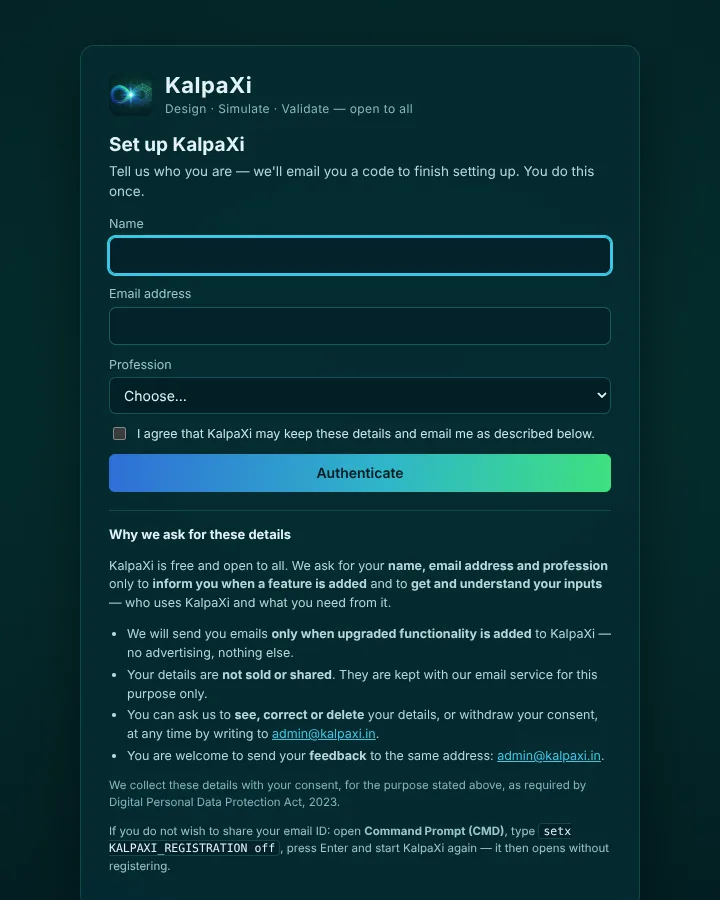

*The set-up window, with the explanation of why the details are asked for.*


*The code screen: the address the code went to, the time left, Send a new code and Change email.*

| | |
|---|---|
| Code valid for | **5 minutes** — the time left is shown under the code |
| No email? | Look in the spam / promotions folder, or click **Send a new code** (possible after 30 seconds; the earlier code then stops working) |
| Wrong address? | Click **Change email** — your name and profession are kept |
| Wrong code | After **5 wrong tries** the code is locked; click **Send a new code** |
| "Can't reach its registration service" | Check the internet connection and try again |

**Why we ask for these details.** KalpaXi is free and open to all. We ask for your name, email
address and profession only to inform you when a feature is added and to get and understand
your inputs. We send emails only when upgraded functionality is added — no advertising. Your
details are not sold or shared. You can ask us to see, correct or delete them, or withdraw your
consent, at any time by writing to [admin@kalpaxi.in](mailto:admin@kalpaxi.in); feedback is
welcome at the same address. We collect these details with your consent, for the purpose stated
above, as required by Digital Personal Data Protection Act, 2023.

**If you do not wish to share your email ID:** open **Command Prompt (CMD)**, type

```
setx KALPAXI_REGISTRATION off
```

press **Enter** and start KalpaXi again — it then opens without registering.

## What's new in V2.1

- **Registration on first start** (above).
- **Model and Solids lists scroll separately** — with many features, the Solids list stays in
  view on the left.
- **Smoother view on large models** — a lighter mesh is shown while the view turns or something
  is dragged, and the full mesh when it is still. After a change, only the solids that changed
  are meshed again.
- **Faster rebuilds** (since V2.0) — the model is rebuilt on its own thread, so the window stays
  responsive, and only from the feature you changed.
- **Mesh & FEM:** with several faces selected, **Normal view** in the right-click menu is
  greyed out (it needs one face).

---

# Getting started

*What KalpaXi is, the window, and moving around.*

## What KalpaXi is

**KalpaXi** lets you design a part and check it in the same place. You sketch, model the part, assemble it and draw it, then mesh it and run stress, thermal and fatigue analyses. Before you cut metal or a mould, you can also check tolerances and injection-moulding rules. It runs in your web browser, on your own computer, and your files stay with you.

It is open-source **parametric CAD** with the **engineering checks built in**, all working on **one model**: change a size and everything that uses it follows. Nothing is uploaded — the project and every file the solvers write stay in your project folder.

We hope it helps creators model quickly and see how their design is going to work.

### What it can be used for

- **Designing parts** — machined, sheet-metal, molded or printed parts, from a sketch to a finished solid with fillets, chamfers, holes and threads.
- **Assemblies** — putting parts together with face-to-face constraints, looking inside with section views, exploded views, and checking whether the parts still fit at the ends of their tolerances.
- **Manufacturing drawings** — views, sections, details, dimensions with tolerances, weld symbols and a parts list, exported as PDF, SVG or DXF.
- **Engineering checks** — stress and deflection, temperatures and thermal stress, fatigue life, mass properties and injection-molding rules, early in the design, before anything is made.
- **Learning** — every input file is kept and readable, and results come with plain-language notes.

### What it has

| Area                          | Tools                                                                                                                                                                              |
|-------------------------------|------------------------------------------------------------------------------------------------------------------------------------------------------------------------------------|
| [Sketch](#making-a-sketch)             | Lines, rectangles, circles, arcs, B-splines, points; trim, extend, join, fillet, offset, project; constraints and dimensions with a live count of the degrees of freedom.          |
| [Part modelling](#making-3d-geometry)   | Extrude / cut (one side, both sides or up to a surface), revolve, fillet (also variable), chamfer, shell, mirror, pattern, move, datum planes, metric threads M1–M24, STEP import. |
| [Several solids](#solids-colour-name-lock)     | Numbered solids with name, colour and lock; Boolean combine / subtract with several solids, cut by a plane or a line.                                                              |
| [Assembly](#assembly-decks-joints-constraints)         | Assembly decks, Insert, constraints, Smart mate, groups, explode, section views, tolerance study.                                                                                  |
| [Drawing](#drawing)           | Standard, projected, section, detail, broken and exploded views; automatic and manual dimensions; callouts, welds, balloons, bill of material; title block.                        |
| [Mass properties](#mass-properties) | Volume, mass, centre of gravity, inertia, principal axes, materials.                                                                                                               |
| [Mesh & FEM](#mesh--fem--stress-and-thermal-analysis)            | Gmsh tetrahedra, CalculiX: stress, thermal and thermal + stress, several solids with contacts, node and element groups.                                                            |
| [Results](#results)           | Contours, probes, sections, reactions, load-case combination, automatic stress convergence.                                                                                        |
| [Fatigue](#fatigue-pylife)           | pyLife: duty cycles, mean-stress models, S-N curves, Miner rules, rainflow; damage and life.                                                                                       |
| [Molding check](#molding-check-injection-molding)        | Wall thickness, draft, undercuts, ribs and bosses, gates and fill.                                                                                                                 |

### How it works

- The **app** runs in the browser: the sketch solver (PlaneGCS), the geometry kernel (OpenCascade) and the 3D view (three.js) all run there.
- A small **solver bridge** runs on your computer next to it and starts the programs that do the heavy work: **Gmsh** (mesh), **CalculiX** (stress and heat) and **Python with pyLife** (fatigue). Modelling works without it; the analyses need it.
- A project is one small `.kxi` file holding the feature history; each study gets its own folder with the mesh, the input file and the results, so you can read them, rerun them or take them elsewhere.

Sketch → part → Assembly → Drawing · Mesh & FEM → Results → Fatigue

### The KalpaXi window

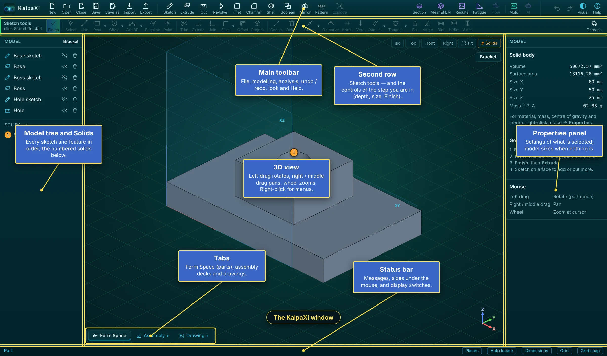

*The KalpaXi window: toolbar, second row, model tree, 3D view, properties panel, tabs and status bar*

| Area                             | What it is for                                                                                                                                                                                                |
|----------------------------------|---------------------------------------------------------------------------------------------------------------------------------------------------------------------------------------------------------------|
| **Main toolbar** (top)           | Files on the left, the modelling tools in the middle, analysis, checks, undo / redo, the look and Help on the right — see [The toolbar](#the-toolbar-project-files-and-the-screen).                                                           |
| **Second row**                   | The sketch tools (they wake up when you sketch). During a step — depth, fillet, shell, section — it shows that step's controls and **Finish**. In an assembly deck or a drawing it holds their own tools.     |
| **Model tree and Solids** (left) | Every sketch and feature in the order it was made, and the numbered solids below — see [How a part is made](#how-a-part-is-made).                                                                                       |
| **3D view** (middle)             | The model. Left-drag rotates, right / middle drag pans, the wheel zooms; right-click for the menus.                                                                                                           |
| **Properties panel** (right)     | The settings of what is selected. With nothing selected it shows the model's size and weight, a short **Getting started** and the **Mouse** buttons. Mesh & FEM, Results and Fatigue use it for their panels. |
| **Tabs** (bottom left)           | **Form Space** (where solids are made), the **assembly decks** and the **drawings**.                                                                                                                          |
| **Status bar** (bottom)          | Messages and hints for each step, the size of what is under the mouse, and the display switches.                                                                                                              |

## Moving around the 3D view

- **Rotate** — Hold the **left** button and drag. While sketching or in any step with a bar (depth, move, shell, section, joints…) the left button does the work, so hold the **right** button and drag to rotate
- **Pan** — Hold the **right** button and drag in the part view; hold the **middle** button and drag anywhere. A middle **click** (no drag) = **Finish / Done** of the current step
- **Zoom** — Roll the **wheel** — it zooms towards the cursor

| Button (top-right of the view)                | What it does                                                                                                                                                                                  |
|-----------------------------------------------|-----------------------------------------------------------------------------------------------------------------------------------------------------------------------------------------------|
| **Iso** **Top** **Front** **Right**           | Jump to a standard view.                                                                                                                                                                      |
| **Fit** or <kbd>F</kbd>         | Zoom so the whole model fits on screen.                                                                                                                                                       |
| Project name (top right, under the buttons)   | The name of the open project.                                                                                                                                                                 |
| **Grid** (status bar, bottom right)           | Show or hide the grid. **Grid snap** next to it turns snapping to the grid on or off while sketching.                                                                                         |
| **Normal** (sketch mode)                      | Look straight at the sketch plane.                                                                                                                                                            |
| Right-click a face or plane → **Normal view** | Look straight at that face (a curved face: square to it where you clicked); the screen's "up" stays as it was.                                                                                |
| **Visual** (top right, next to Help)          | Appearance of KalpaXi: **Default** (deep teal, matching the start-up picture — the standard look), **Dark**, **Gray** or **Bright** (panels, 3D view and sketch lines). Remembered next time. |

> **Tip:** While sketching, the left button draws: rotate with the **right** button, pan with the **middle** button. The tabs at the bottom left of the view switch between the **Form Space** (modelling) and the [assembly decks](#assembly-decks-joints-constraints).

# The toolbar

*The buttons along the top, in three groups.*

## The toolbar: project, files and the screen

The toolbar has three groups: **project and files** at the left end (this section), the [modelling tools](#the-toolbar-modelling-tools-and-the-status-bar) in the middle and the [analysis, checks and look](#the-toolbar-analysis-checks-undo-look-and-help) at the right end.

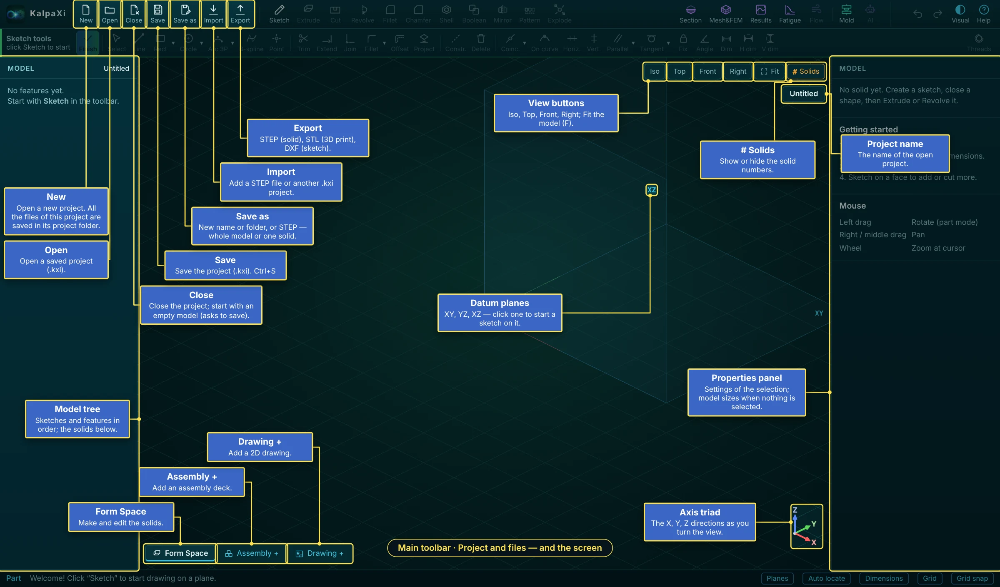

*Project and file buttons, and the parts of the screen around the model*

| Button                                                            | What it does                                                                                                                 |
|-------------------------------------------------------------------|------------------------------------------------------------------------------------------------------------------------------|
| **New**                                                           | Starts a new project. All the files of a project (the `.kxi` file and its study folders) are kept in its own project folder. |
| **Open**                                                          | Opens a saved project (`.kxi`).                                                                                              |
| **Close**                                                         | Closes the project and starts with an empty model (asks to save first).                                                      |
| **Save** <kbd>Ctrl</kbd>+<kbd>S</kbd> | Saves the project.                                                                                                           |
| **Save as**                                                       | A new name or folder, or a STEP file — of the whole model or of one solid.                                                   |
| **Import**                                                        | Adds a STEP file (as a solid) or another `.kxi` project.                                                                     |
| **Export**                                                        | STEP (solid), STL (3D printing), DXF (a sketch).                                                                             |

Around the model:

- **View buttons** (top right of the view): **Iso** **Top** **Front** **Right** and **Fit** (<kbd>F</kbd>); **\# Solids** shows or hides the solid numbers. Under them, the **project name**.
- **Datum planes** XY, YZ, XZ — click one to start a sketch on it (**Planes** in the status bar shows or hides them).
- **Axis triad** (bottom right): the X, Y, Z directions as you turn the view.
- **Tabs**: **Form Space** (make and edit the solids), **Assembly +** (add an assembly deck), **Drawing +** (add a 2D drawing).

More about the save, open and export windows: [Saving, opening, exporting](#saving-opening-exporting).

## The toolbar: modelling tools and the status bar

The middle of the toolbar holds the tools that make and change the solids. They work in the Form Space; while you sketch or are in a step they wait until you finish.

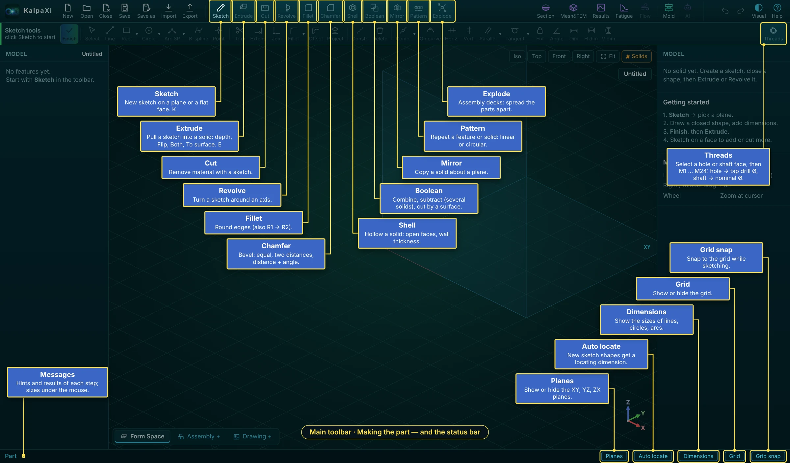

*The modelling tools of the main toolbar, Threads at the right of the second row, and the status bar*

| Tool                                             | What it does                                                                                      |
|--------------------------------------------------|---------------------------------------------------------------------------------------------------|
| **Sketch** <kbd>K</kbd>            | A new sketch on a plane or a flat face — [Making a sketch](#making-a-sketch).                              |
| **Extrude** <kbd>E</kbd> · **Cut** | Pull a sketch into a solid, or remove material with it: depth, flip, both sides, up to a surface. |
| **Revolve**                                      | Turn a sketch around an axis.                                                                     |
| **Fillet** · **Chamfer**                         | Round edges (also R1 → R2 along an edge) · bevel edges (equal, two distances, distance + angle).  |
| **Shell**                                        | Hollow a solid: faces to open, wall thickness.                                                    |
| **Boolean**                                      | Combine or subtract solids (several at once), or cut a solid by a surface.                        |
| **Mirror** · **Pattern**                         | Copy a solid about a plane · repeat a feature or solid in a row or a circle.                      |
| **Explode**                                      | Assembly decks only: spread the parts apart.                                                      |
| **Threads** (right end of the second row)        | Select a hole or a shaft face, then M1 … M24: a hole gets the tap drill Ø, a shaft the nominal Ø. |

How each tool is used: [Making 3D geometry](#making-3d-geometry).

### The status bar

| Item                     | What it does                                                                                          |
|--------------------------|-------------------------------------------------------------------------------------------------------|
| Messages (left)          | Hints and results of each step; the size of what is under the mouse (edge length, radius, face area). |
| **Planes**               | Show or hide the XY, YZ, XZ planes.                                                                   |
| **Auto locate**          | Each new sketch shape gets a locating dimension.                                                      |
| **Dimensions**           | Show the sizes of lines, circles and arcs in sketches.                                                |
| **Grid** · **Grid snap** | Show the grid · snap to it while sketching.                                                           |

## The toolbar: analysis, checks, undo, look and Help

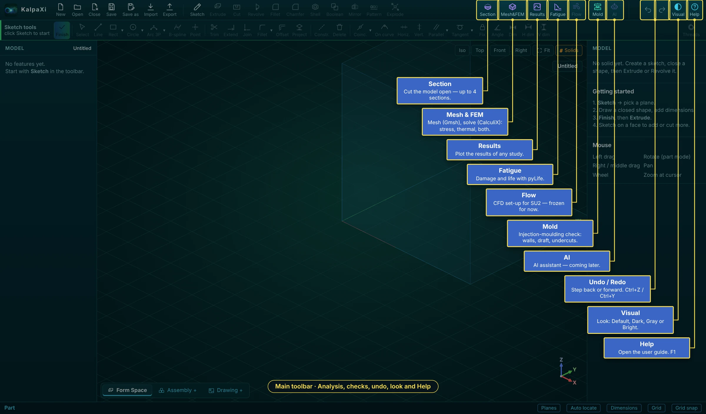

*The right end of the toolbar: section view, the analyses, the molding check, undo / redo, Visual and Help*

| Button                               | What it is for                                                                                                                                                                                                                       |
|--------------------------------------|--------------------------------------------------------------------------------------------------------------------------------------------------------------------------------------------------------------------------------------|
| **Section**                          | Cut the model open to look inside — up to 4 sections, in the model, the assembly decks and the results ([Section view](#section-view)).                                                                                                   |
| **Mesh&FEM**                         | Meshes a solid (Gmsh) and solves it (CalculiX): **stress**, **thermal** or **thermal + stress**, with supports, forces, pressures, gravity, temperatures, convection, heat flux, radiation and heat generation ([Mesh & FEM](#mesh--fem--stress-and-thermal-analysis)). |
| **Results**                          | Plots the results of any study of the project — displacement, stresses, safety factor, temperature — and adds load cases together ([Results](#results)).                                                                             |
| **Fatigue**                          | Turns the stress studies into fatigue damage and life with pyLife ([Fatigue](#fatigue-pylife)).                                                                                                                                             |
| **Flow** · **AI**                    | CFD set-up for SU2 and an AI assistant — built, frozen in this release ([Flow and AI](#flow-and-ai-frozen)).                                                                                                                                        |
| **Mold**                             | Injection-molding check: walls, draft, undercuts, ribs, gates ([Molding check](#molding-check-injection-molding)).                                                                                                                                              |
| Undo / Redo                          | A step back or forward — <kbd>Ctrl</kbd>+<kbd>Z</kbd> / <kbd>Ctrl</kbd>+<kbd>Y</kbd>.                                                                                        |
| **Visual**                           | The look of KalpaXi: Default, Dark, Gray or Bright.                                                                                                                                                                                  |
| **Help** <kbd>F1</kbd> | This guide.                                                                                                                                                                                                                          |

In short, the analysis chain is: **Mesh&FEM** sets up a study on a solid (or several solids of an assembly) — material, supports, loads, mesh — and runs CalculiX. **Results** shows any study that has run, also after the project is reopened, and can add several studies together with factors. **Fatigue** takes one or more of those stress studies as load cases, each with its load range, number of cycles and mean-stress model, and gives the damage and life at every node. **Mold** checks a solid against injection-molding rules and colours the part where a rule is not met. Each has its own chapter below.

# Making a part

*From a sketch to a finished solid.*

## How a part is made

Every solid starts as a flat 2D drawing (a **sketch**) that is turned into 3D by a **feature**.

1 · Sketch on a plane → 2 · Draw a closed shape → 3 · Add dimensions → 4 · Finish → 5 · Extrude / Revolve → 6 · Sketch on a face, cut, fillet…

The left-hand **Model** list keeps the full history. Click a feature to change its values in the right-hand panel, double-click it to edit it; the part rebuilds automatically.

### The left side: Model tree and Solids

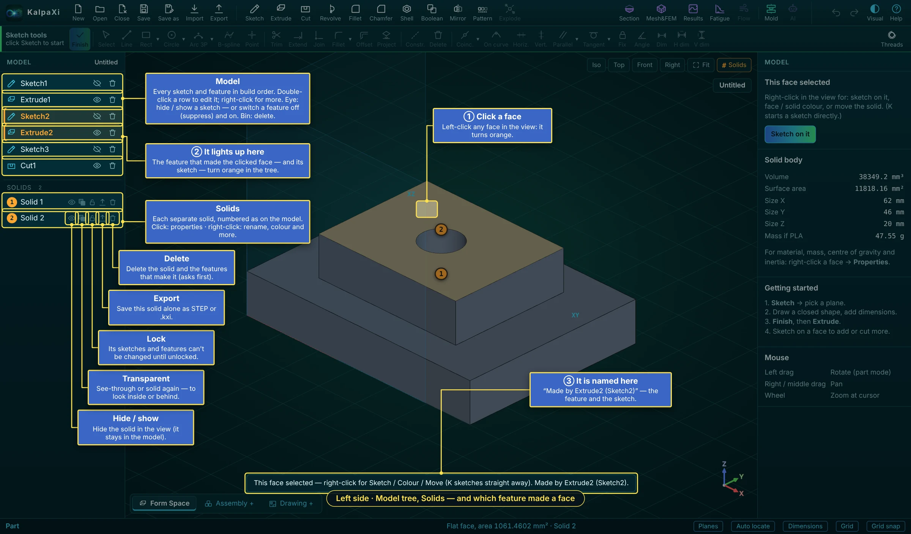

*The Model tree, the Solids list with its buttons — and how to find the feature that made a face*

- **Model** lists every sketch and feature in build order. Click one: its settings open in the right panel. Double-click: edit it (a sketch opens, an extrude shows its depth handle). Right-click: more commands. The **eye** hides or shows a sketch, or switches a feature off (suppress) and on; the **bin** deletes it.
- **Solids** lists each separate solid with the number shown on the model. Click a solid for its properties; right-click it to rename, colour, lock and more. Its five buttons: **hide / show**, **transparent**, **lock**, **export** (that solid alone, STEP or `.kxi`) and **delete** (with the features that make it, after asking) — see [Solids: colour, name, lock](#solids-colour-name-lock).

> **Tip:** **Which sketch or extrude made this face?** ① Click the face in the view: it turns orange. ② The feature that made it and its sketch light up **orange** in the Model tree. ③ The status bar names them, e.g. “Made by Extrude2 (Sketch2)”. Double-click the lit feature to change it.

### Right-click on a face, the second row and the right panel

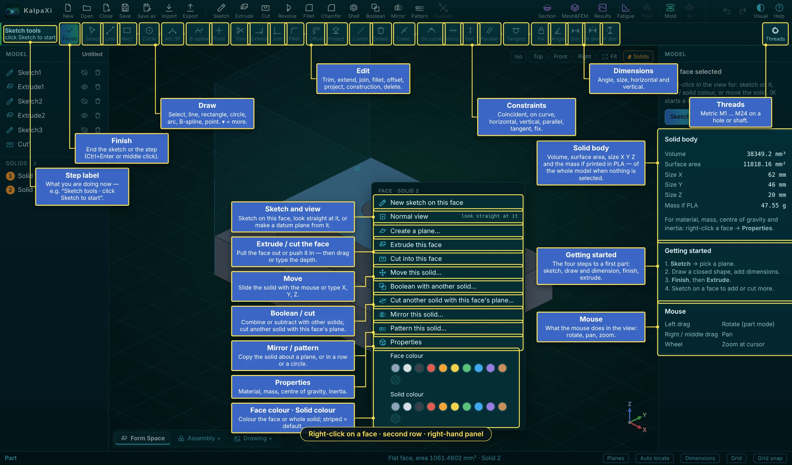

*Right-click menu of a face, the sketch tools in the second row, and the right-hand panel*

| Right-click a face                                                      | What it does                                                                                      |
|-------------------------------------------------------------------------|---------------------------------------------------------------------------------------------------|
| New sketch on this face · Normal view · Create a plane…                 | Sketch on the face, look straight at it, or make a datum plane from it.                           |
| Extrude this face · Cut into this face                                  | Pull the face out or push it in — then drag or type the depth.                                    |
| Move this solid…                                                        | Slide the solid with the mouse or type X, Y, Z.                                                   |
| Boolean with another solid… · Cut another solid with this face's plane… | Combine or subtract with other solids; cut another solid with the face's plane.                   |
| Mirror this solid… · Pattern this solid…                                | Copy the solid about a plane, or in a row or a circle.                                            |
| Properties                                                              | Material, manufacturing method, mass, centre of gravity, inertia ([Mass properties](#mass-properties)). |
| Face colour · Solid colour                                              | Colour the face or the whole solid; the striped swatch = back to the default.                     |

The **second row** holds the sketch tools. They wake up in a sketch: on the left the **step label** (what you are doing now) and **Finish**, then the **Draw**, **Edit**, **Constraints** and **Dimensions** groups — each described in the sections below. A ▾ next to a button opens more tools of that kind. **Threads** sits at the right end and works outside a sketch.

The **right panel**, with nothing selected, shows: **Solid body** — the volume, surface area, size in X, Y, Z and the mass if it were printed in PLA (of the whole model); **Getting started** — the four steps to a first part (sketch, draw and dimension, finish, extrude); and **Mouse** — what the buttons do in the view. When something is selected it shows that item's settings instead.

## Making a sketch

### Start a sketch

1.  Click **Sketch** in the toolbar (or press <kbd>K</kbd>).
2.  Click one of the three origin planes — **XY** (top), **XZ** (front), **YZ** (right) — or a **flat face** of the solid. The buttons in the right panel pick a plane too.
3.  A grid appears on the plane and the **Line** tool is ready. The view stays as it was — press **Normal** (top right) to look straight at the plane. The sketch tools are in the **second bar under the main toolbar** (always there, frozen until you sketch), with the sketch's name and plane on the left and **Finish** at **both ends**. The main toolbar stays in view but is locked until you finish — only **Help** and **Visual** still work.

> **Tip:** **Turning the view while sketching:** hold the **right** button and drag (any tool) — the tool you had stays on afterwards. You keep drawing on the sketch plane in the turned view: points land on the plane where you click. **Normal** turns it back square to the sketch.

> **Tip:** **Quicker:** left-click a flat face or plane (it turns orange), then right-click → **New sketch on this face**.

### Drawing tools

| Tool      | Key                        | How to draw                                                                                                                                                        |
|-----------|----------------------------|--------------------------------------------------------------------------------------------------------------------------------------------------------------------|
| Line      | <kbd>L</kbd> | Click a start point, then each next point. Keeps going as a chain; <kbd>Esc</kbd> or right-click ends it. Clicking the first point closes the shape. |
| Rectangle | <kbd>R</kbd> | Click two opposite corners.                                                                                                                                        |
| Circle    | <kbd>C</kbd> | Click the centre, then a point on the rim.                                                                                                                         |
| Circle 3P |                            | Click three points on the circle.                                                                                                                                  |
| Arc 3P    | <kbd>A</kbd> | Click the start, the end, then a point the arc passes through.                                                                                                     |
| Arc Ctr   |                            | Click the centre, the start (sets the radius), then the end (anticlockwise).                                                                                       |
| B-spline  | <kbd>B</kbd> | Click control points; <kbd>Enter</kbd>, double-click or right-click to finish. Click the first point again to close it.                              |
| Point     | <kbd>P</kbd> | A single point, handy for dimensions and constraints.                                                                                                              |

### Helpers while drawing

- **Snapping** — the cursor jumps to existing points (they join), onto lines/circles (the point stays on them) and to the grid. Turn grid snapping off with **Grid snap** in the status bar.
- **Horizontal / vertical** — a line drawn within 3° of level or upright snaps straight and gets an H or V marker.
- **Closed shapes are shaded blue** — only shaded areas become solid.
- **Construction lines** (<kbd>G</kbd> on selected curves) are dashed helpers that don't become solid — useful as a revolve axis or a reference.

### Finish

Click **Finish** (at either end of the sketch bar), click the **middle** mouse button, press <kbd>Ctrl</kbd>+<kbd>Enter</kbd>, or right-click → **Finish sketch**. The sketch tools freeze again and the main toolbar works. To change a sketch later, double-click it in the Model list. The eye button in the list hides or shows a sketch (or switches a feature off); the bin deletes it.

## Editing a sketch

| Action                                 | How                                                                                                                 |
|----------------------------------------|---------------------------------------------------------------------------------------------------------------------|
| Select                                 | <kbd>S</kbd>, then click; <kbd>Shift</kbd>+click adds to the selection.                 |
| Move                                   | Drag a point, a line or a circle's rim. Constraints and locked dimensions are kept while you drag.                  |
| Join points                            | Drag a point onto another point (they become one) or onto a line/circle (it stays on it).                           |
| Delete                                 | Select and press <kbd>Del</kbd>.                                                                      |
| Trim <kbd>X</kbd>        | Click the piece of a curve to cut away; it is removed up to the nearest crossings (shown red first).                |
| Extend <kbd>W</kbd>      | Click near the end of a line/arc; it stretches to the next curve it would hit.                                      |
| Join corner <kbd>J</kbd> | Click two curves; both are extended or trimmed to meet in a sharp corner.                                           |
| Project <kbd>U</kbd>     | Copies an edge of the solid (or a curve of another sketch) into this sketch as fixed geometry.                      |
| Undo / Redo                            | <kbd>Ctrl</kbd>+<kbd>Z</kbd> / <kbd>Ctrl</kbd>+<kbd>Y</kbd> |

> **Tip:** Right-click anywhere in a sketch for a menu with **every** sketch command.

## Constraints

Constraints are rules the sketch must obey. Select the items first, then click the button (or press the key).

| Constraint               | Key                                                     | Select                                       |
|--------------------------|---------------------------------------------------------|----------------------------------------------|
| Coincident               |                                                         | Two points (they become one)                 |
| On curve                 | <kbd>O</kbd>                              | A point and a line/circle/arc                |
| Horizontal / Vertical    | <kbd>H</kbd> / <kbd>V</kbd> | Lines (or two points)                        |
| Parallel / Perpendicular |                                                         | Two lines                                    |
| Tangent                  | <kbd>T</kbd>                              | A line and a circle/arc, or two circles/arcs |
| Equal                    | <kbd>E</kbd>                              | Two or more lines, or circles/arcs           |
| Fix                      |                                                         | Points or curves to pin in place             |

The status bar shows how many **degrees of freedom** are left. At 0 the sketch turns **green — fully constrained**. A constraint that would contradict the others is refused, so the sketch never breaks.

## Dimensions

### Sizes are shown automatically

Every line shows its length, every circle its diameter (Ø) and every arc its radius (R). These are **unlocked** `25 🔓` — they follow the shape as you drag it.

### Change a size

1.  **Double-click** the number.
2.  Type the new value and press <kbd>Enter</kbd>. Simple maths works too, e.g. `25.4*2`.
3.  The shape resizes to match.

### Lock a size

Click the small **lock icon** on the label. A **locked** dimension `25 🔒` is enforced: dragging can't change it and it can't be edited until you click the lock again to unlock it.

### Dimension tools

| Tool      | Key                                                       | Pick                                                                                                                                                                 |
|-----------|-----------------------------------------------------------|----------------------------------------------------------------------------------------------------------------------------------------------------------------------|
| **Dim**   | <kbd>D</kbd>                                | A line → its length; a circle → diameter; an arc → radius; two points, a point and a line, or two parallel lines → the distance between them; two lines → the angle. |
| **H dim** | <kbd>Shift</kbd>+<kbd>H</kbd> | Distance measured **horizontally**: one line → its width; two items → their horizontal spacing.                                                                      |
| **V dim** | <kbd>Shift</kbd>+<kbd>V</kbd> | Distance measured **vertically**: one line → its height; two items → their vertical spacing.                                                                         |
| **Angle** | <kbd>N</kbd>                                | One line → its angle from horizontal; two lines → the angle between them.                                                                                            |

With nothing selected, press the key (or button) and then click the items. Click the first item and then empty space to dimension a single line. With items already selected, the key applies straight away.

> **Tip:** **Dimension to the solid:** when sketching on a face, the solid's edges in that plane show as purple dotted lines. You can pick them like your own lines, e.g. "hole centre 15 mm from the edge".

> **Tip:** **Auto locate** (status bar): each new, unconnected shape gets an unlocked dimension placing it from the nearest existing point or line. Lock it to fix the position.

## Making 3D geometry

| Feature                                | What it does                                                                                                                                                           | Settings (right panel)                                                                                                                                                                       |
|----------------------------------------|------------------------------------------------------------------------------------------------------------------------------------------------------------------------|----------------------------------------------------------------------------------------------------------------------------------------------------------------------------------------------|
| **Extrude** <kbd>E</kbd> | Pushes the closed shapes of a sketch into a solid.                                                                                                                     | Sketch, distance, direction (along the normal / reversed / both sides), operation: **Add (join)**, **New solid (separate)**, **Cut**, **Intersect**.                                         |
| **Cut**                                | Same as Extrude but removes material (starts reversed, into the solid).                                                                                                | As Extrude.                                                                                                                                                                                  |
| **Revolve**                            | Spins a shape around an axis (a pulley, a cup…).                                                                                                                       | Axis: the sketch's horizontal or vertical axis, or any line in the sketch (a construction line is ideal); angle (360 = full turn).                                                           |
| **Fillet**                             | Rounds edges.                                                                                                                                                          | Radius — typed, or **hold the left button and drag** away from an edge. Click edges to add / remove them, then **Done**. **Variable radius**: R1 and R2 at the two ends of one edge (below). |
| **Chamfer**                            | Bevels edges.                                                                                                                                                          | Type: **Equal distance**, **Two distances (D1 × D2)** or **Distance + angle**; sizes typed or dragged (below).                                                                               |
| **Shell**                              | Hollows the solid, leaving walls, with the faces you pick left open.                                                                                                   | Wall thickness — typed or dragged; faces to open (below).                                                                                                                                    |
| Create a plane                         | Right-click a flat or curved face → **Create a plane…**: a reference plane to sketch on.                                                                               | Turn it about an axis by dragging, align to X / Y / Z, set an angle, or click a straight edge as the axis.                                                                                   |
| Extrude / Cut this face                | Right-click a flat face: pulls it out 10 mm or pushes it in 5 mm.                                                                                                      | Distance, direction.                                                                                                                                                                         |
| Move solid                             | Right-click a face → **Move this solid…**, then drag it with the left button (see below).                                                                              | Move X / Y / Z (mm) in the bar; rotation about X, Y or Z in the panel afterwards.                                                                                                            |
| **Boolean**                            | Combines solids into one, subtracts solids from another, or **cuts a solid in two along a plane or a sketched line**. The result is a **new solid with a new number**. | Combine / Subtract / Cut by surface, the solids, the cutting plane or line, keep or delete each original (see below).                                                                        |
| **Import**                             | Brings in a STEP file as a solid.                                                                                                                                      | Add / new solid / cut / intersect.                                                                                                                                                           |

### Extrude both ways, or up to a surface

- **Both** (in the depth bar or the extrude's panel): the shape goes out on both sides of the sketch; **Depth 2** sets the other side's depth (empty = the same as Depth).
- **To surface**: click the face the extrude (or cut) should run up to. A flat face is used as its whole plane, a curved face as it is. The panel shows **Extends to** with the face; **Change…** picks another face, **Distance** goes back to a typed depth.
- From a sketch on a solid's face the extrude asks: **Join Solid N**, **New separate solid** or **Join to another solid…** (click it). If the new shape does not touch the solid it should join, KalpaXi warns “two solids are formed due to non continuity”.

### Threads (ISO metric M1 – M24)

1.  Click the round face of a **hole** or a **shaft** (outside a sketch).
2.  **Threads** (right end of the second row). The window lists M1 … M24 with pitch, tap drill Ø and nominal Ø (second-choice sizes marked 2nd).
3.  Pick a size. A **hole** is made the size's **tap drill** Ø (ISO 2306); a **shaft** is turned down to the **nominal** Ø (ISO 261). Sizes that don't fit (bigger than the shaft) are marked **infeasible**.

The thread is a feature in the tree: click it to change the size. Drawings show it with the thread callout and cosmetic thread lines.

> **Tip:** **Boolean with several solids:** in the Boolean window tick **Also add** / **Also remove** to combine or subtract more solids in one go.

### Boolean: Combine and Subtract solids

With **Add (join)** a new extrude melts into every solid it touches. To keep it apart — so it can later be combined with, or subtracted from, another solid — set its operation to **New solid (separate)**: it becomes its own solid with the next number, even where it overlaps another one.

1.  Click **Boolean** in the toolbar (or right-click a face → **Boolean with another solid…**, which pre-selects that face's solid; or right-click empty space → **Boolean (Combine / Subtract)…**). Combine and Subtract need two solids; with one solid only **Cut by surface** (below) is offered.
2.  Choose **Combine** (A + B: one solid made of both) or **Subtract** (A − B: Solid A with Solid B's volume removed).
3.  Pick the two solids by number.
4.  Under **Originals**, tick **Keep Solid A** and/or **Keep Solid B** to keep the original solids as they were. Unticked originals are deleted (used up). The window shows the result before you press **OK**, e.g. “Result: Solid 3 = Solid 1 − Solid 2”.

- The result always gets a **new number** (the next free one); kept originals keep theirs. Numbers stay put when you rebuild, save and reopen.
- A kept original that overlaps the result (A after a Subtract, A and B after a Combine) is **hidden** so it doesn't show through the result; show it again with its eye button in the Solids list.
- The Boolean is a feature in the tree like any other: click it to switch between Combine and Subtract, change **Keep A** / **Keep B**, **Swap A and B**, suppress or delete it.
- Combine needs the solids to touch or overlap (otherwise they can't become one solid); Subtract needs B to overlap A. If Subtract cuts A into pieces, each piece is a new solid.
- After a Boolean (or a New solid), later features work solid by solid: an Add extrude joins only the solids it touches, a Move moves one solid without merging it into others, a fillet rounds the picked edges on each solid that has them.

### Boolean: Cut by surface (with a plane or a line)

Splits one solid into two pieces along a flat **plane**, or along a **line** (or a chain of lines) drawn in a sketch — like sawing the part. It works with a single solid, so the Boolean button is available as soon as there is one solid.

1.  **Make the cutter** (if you don't use a main plane):
    - **Plane:** the main planes XY, XZ, YZ are always offered; for any other position right-click a face → **Create a plane…** (a datum plane, also offset or turned).
    - **Line:** make a sketch on a plane that crosses the part and draw one **open** line or a chain of joined lines (an L, a zig-zag) right across it. Closed outlines, branches and construction lines are not used. The line is extended at both ends, then swept along the sketch's normal through the whole part.
2.  Click **Boolean** → **Cut by surface**. Or right-click a plane → **Cut a solid with this plane…**, or right-click a flat face → **Cut another solid with this face's plane…** (the cutter is then filled in).
3.  Pick **Solid A** (the solid to cut) and **Cut with** (XY, XZ, YZ, your datum planes, and the sketches with an open line chain).
4.  **Keep**: **Both pieces** (two new solids), **Side 1** only (the side the plane's normal points to, or the **left** of the line as it was drawn — from its first to its last point) or **Side 2** only.
5.  Under **Originals**, tick **Keep Solid A** to keep the uncut solid as well (it is hidden so it doesn't show through), then **OK**.

- Each piece is a new solid with the next free number. The **Cut by surface** feature stays in the tree: click it to change **Cut with**, **Keep** or **Keep original**; move or edit the plane or the sketch and the cut follows.
- "The cutting surface doesn't pass through the solid" — move the plane or the line so it crosses the part. "… must form one open chain" — the sketch has a closed shape or a branch; draw a single open line chain.

> **Tip:** Typical uses: split a housing into a lid and a base (cut by a plane, keep both), cut a part in half to model only one side, or trim a part along a stepped line drawn in a sketch.

### Shell

1.  Click **Shell** in the toolbar.
2.  **Click the faces to open** (they turn orange); click one again to keep it closed.
3.  **Hold the left button and drag** from a face: the wall thickness follows the cursor and the hollowed solid shows while you drag — or type the **Thickness** in the bar. Walls go inwards.
4.  **Done** (either end of the bar, <kbd>Enter</kbd> or a middle click) — or **Cancel** (<kbd>Esc</kbd>).

> **Tip:** If the inside walls would run into other features (a hole or pocket deeper than the wall, a round smaller than the wall), OpenCascade can't make the shell: KalpaXi says so instead of making a broken solid. Use a thinner wall, or switch off the feature in the way.

### Chamfer options

- **Equal distance** — the same distance D on both faces.
- **Two distances** — D1 on the face shown **orange**, D2 on the other; **Flip** swaps the faces. Dragging from the edge sets D1 and D2 separately.
- **Distance + angle** — D on the orange face and the bevel angle (between 0° and 90°).

### Variable-radius fillet

In the fillet bar tick **Variable radius**: the fillet goes from **R1** at one end of the edge to **R2** at the other (labels show which end is which). Only one line or curve can be picked; picking another one replaces it. Type R1 and R2, or drag near an end to set that end's radius.

### Setting the depth with the mouse

After **Extrude** or **Cut** (or right-click a face → **Extrude this face** / **Cut into this face**) a bar opens under the main toolbar and the new shape is shown **see-through** (blue for an extrude, red for a cut). **Hold the left button and move the mouse**: the depth follows the cursor along the sketch's normal, and stops following when you let go. Type an exact **Depth** in the bar, **Flip** it to the other side, then **Finish** (<kbd>Enter</kbd>) — or **Cancel** (<kbd>Esc</kbd>). The main toolbar is locked until then. Turn the view with the right button, pan with the middle one; a middle click = Finish. Later: double-click the feature (or **Drag depth** in its panel) to drag it again.

### Sketch on a solid's face: join, new solid, or which solid to cut

- **Extrude** from a sketch on a face of Solid N asks: **Join to Solid N** (it grows and keeps its number) or **New separate solid** (its own number).
- **Cut** from a sketch on a face of Solid N asks: **Cut Solid N** (only that solid is cut, even where the cut passes through others) or **Pick another solid to cut…** — then click the solid to cut.
- An extrude from a sketch that is not on a solid's face makes a **separate solid**. Solids that overlap are **never merged automatically** — not by an extrude and not by a move; use **Boolean** → Combine to merge them.

### Moving a solid with the mouse

Right-click a face → **Move this solid…**. The solid gets an orange see-through copy; **hold the left button and drag** it. It slides in the main plane (XY, XZ or YZ) that is most square to your view — from the Top view it moves in XY, from the Front view in XZ; turn the view (right button) to move it in another plane. Steps are 0.5 mm; exact X / Y / Z values can be typed in the bar. **Finish** (<kbd>Enter</kbd>) or **Cancel** (<kbd>Esc</kbd>).

### Sizes under the mouse

Move the mouse over the model and the status bar (bottom) shows the size of what is under it: an **edge** — line length, or circle / arc radius, diameter and length; a **curved face** — cylinder / cone / sphere radius and area; a **flat face** — its area. In a sketch it shows the length of a line, the radius of a circle or arc (with arc length and angle), and the length of a curve.

### Example: a plate with a hole

1.  **Sketch** → click **XY**.
2.  <kbd>R</kbd>: click two corners for a rectangle. <kbd>C</kbd>: draw a circle inside it.
3.  Double-click the rectangle's sizes and type `60` and `40`; double-click the circle's Ø and type `10`. Lock them if you want them fixed.
4.  **Finish**, then **Extrude**; set the distance to `5`. The circle becomes a hole automatically.
5.  Click a top edge, right-click → **Fillet**, set the radius, press <kbd>Enter</kbd>.

> **Tip:** Every feature can be renamed, **suppressed** (temporarily switched off) or deleted from the right panel. Clicking empty space shows the volume, size and estimated weight of the part.

## Solids: colour, name, lock

Every separate solid is listed under **Solids** below the feature tree, with its number. Each row has five buttons:

| Button      | What it does                                     |
|-------------|--------------------------------------------------|
| Eye         | Hide / show the solid.                           |
| Two squares | Transparent / opaque.                            |
| Padlock     | **Lock** / unlock (below).                       |
| Arrow       | Save as / Export this solid.                     |
| Bin         | Delete the solid and the features that build it. |

- **Colour:** right-click a face → **Solid colour** colours only the solid that face belongs to; the other solids keep theirs. **Face colour** colours just that face and shows over the solid's colour. The number badge in the list takes the solid's colour.
- **Rename:** right-click a solid in the list → **Rename…** (or double-click its name), type, <kbd>Enter</kbd> (<kbd>Esc</kbd> cancels). The **number never changes**; menus show it as “Solid 1 · Bracket”.
- **Lock:** while a solid is locked, its sketches can't be opened and the features that build it can't be edited, switched off or deleted, and the solid can't be deleted. Locked items show a small padlock in the tree and their panel is greyed out (the name stays editable). Unlock with the same button or the right-click menu. The lock covers the features that existed when you locked it.

The name, colour and lock are saved with the project.

# Assemblies and drawings

*Putting parts together, looking inside, weighing them, and drawing them.*

## Assembly: decks, joints, constraints

A project has tabs at the **bottom left** of the 3D view, like sheets in a spreadsheet. **Form Space** is where solids are made and edited. **Assembly +** adds an **Assembly Deck** (up to 2: Assembly Deck-1 and -2) where solids from the Form Space are put together. **Drawing +** adds a [drawing sheet](#drawing). Click a tab to switch; right-click a deck tab to rename or delete it.

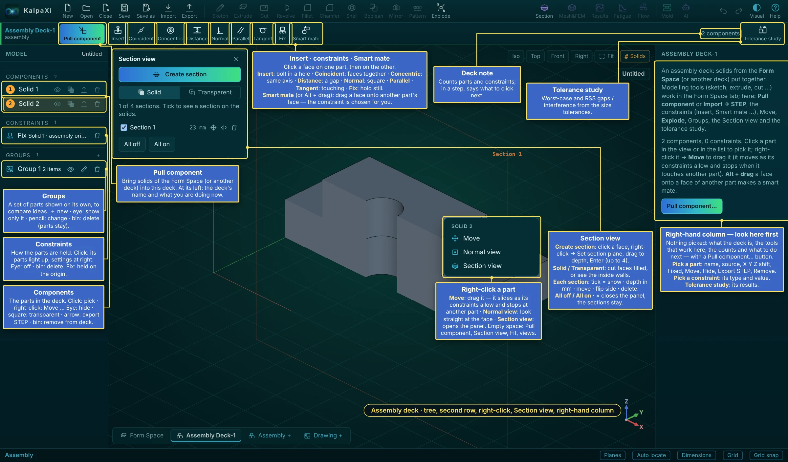

*An assembly deck: the tree, the second row, the right-click menu, the Section view panel and the right-hand column*

### What you see in a deck

| Where                           | What it is                                                                                                                                                                                                                                                                                                                                                                                                 |
|---------------------------------|------------------------------------------------------------------------------------------------------------------------------------------------------------------------------------------------------------------------------------------------------------------------------------------------------------------------------------------------------------------------------------------------------------|
| **Components** (left)           | Every part in the deck, numbered as in the Form Space. Click: pick it · right-click: Move and more. Buttons: **eye** hide / show · **square** transparent · **arrow** export STEP in its deck position · **bin** remove from the deck (the solid stays in the Form Space).                                                                                                                                 |
| **Constraints** (left)          | How the parts are held. Click one: its two parts light up and its settings show on the right. Eye: switch off (kept, not solved) · bin: delete. “Fix Solid 1 · assembly origin”: the first part is held on the origin.                                                                                                                                                                                     |
| **Groups** (left)               | A chosen set of parts shown on its own — to compare ideas or look at a sub-group. **＋**: new group (name, tick the parts) · click or eye: show only this group (again: show all) · pencil: change name or parts · bin: delete the group (the parts stay).                                                                                                                                                 |
| **Pull component**              | Brings solids of the Form Space — or a whole other deck, as a sub-assembly — into the deck. On its left: the deck's name and what you are doing now.                                                                                                                                                                                                                                                       |
| **Insert**                      | A bolt in a hole in one go: click the round face of the part going in (near its head), then the hole — same axis, head flush.                                                                                                                                                                                                                                                                              |
| Constraint buttons              | **Coincident**, **Concentric**, **Distance**, **Normal**, **Parallel**, **Tangent**, **Fix** — click a face on one part, then on the other (below).                                                                                                                                                                                                                                                        |
| **Smart mate**                  | Drag a face of one part onto a face of another: the constraint is chosen for you (flat on flat: coincident, round on round: concentric, round on flat: tangent). <kbd>Alt</kbd> + drag does it at any time.                                                                                                                                                                                  |
| Deck note · **Tolerance study** | The count of parts and constraints (during a step: what to click next) · gaps and interference from the size tolerances (below).                                                                                                                                                                                                                                                                           |
| **Explode** (main toolbar)      | Spreads the parts apart with explode lines; **Spread** in the second row sets how far. Press again to collapse. A drawing of the deck can show this as an exploded view.                                                                                                                                                                                                                                   |
| Right-click a part              | **Move** — drag it; it slides only as its constraints allow and stops when it touches another part · **Normal view** — look straight at that face · **Section view** — opens the panel. On empty space: Pull component, Section view, Fit, Iso / Top / Front.                                                                                                                                              |
| **Right-hand column**           | Look here first. With nothing picked it explains the deck: what it is, which tools work here, how many parts and constraints there are, and what to do next — with a **Pull component…** button. Pick a part: its name, where it comes from, its X Y Z shift, Fixed, Move, Hide, Export STEP, Remove from deck. Pick a constraint: its type and value. After a tolerance study its results are shown here. |

### How to build an assembly — step by step

1.  **Model the parts** in the Form Space, each as its own solid (extrude with **New solid (separate)**, or import STEP). Give them names (right-click in the Solids list → Rename…) — the names appear in the deck, the parts list and the tolerance study.
2.  Click **Assembly +** at the bottom left. An empty **Assembly Deck-1** opens and the second bar becomes the assembly bar.
3.  **Pull component** → tick the solids and how many of each → **Pull**. The **first** part pulled in is **fixed** on the assembly's coordinate system; the others are free.
4.  **Place the parts** with **constraints** (face to face rules, several per part, below): click the constraint button, click a face of the part that **moves**, then the matching face of the part it goes **to**. **Insert** puts a bolt in a hole in one go; **Smart mate** (or <kbd>Alt</kbd> + drag) picks the constraint for you.
5.  Check each part's panel: it shows how many **degrees of freedom** are left (0 = fully placed). Drag a part with **Move** (right-click it) to see how it can still move.
6.  Optional: **Tolerance study** (right end of the bar) for the gaps and interference between parts from their tolerances (below), **Section** to look inside, and a **Drawing +** of the deck with a parts list.
7.  **Save** — the decks, their parts, joints and constraints are saved in the `.kxi` project.

### In a deck

- Sketch, Extrude, Cut, the other modelling tools and the analysis tools (Mesh&FEM, Results, Fatigue, Mold) are greyed out — they work in the Form Space. The file menu and the **Section** view work.
- The second bar holds **Pull component**, **Insert**, the constraint buttons (Coincident … Fix), **Smart mate** and **Tolerance study**; **Explode** is in the main toolbar.
- The Model list shows the **Components** pulled in, the **Constraints** and the **Groups** (and **Joints** from older files).

### Pull component

1.  **Pull component** opens a window with two choices: **Pull component** (the solids of the Form Space) or **Pull assembly** (the other deck, pulled in as a whole).
2.  Tick what to bring in and set **× how many**; the same solid can be pulled in several times.
3.  **Pull**. The solids keep their names; copies are numbered, e.g. “Bracket \<1\>”, “Bracket \<2\>”.

A pulled solid first sits where it is in the Form Space; copies, and anything that would overlap, go to its right. Changes made in the Form Space (shape, colour) show in the decks. A deck can't be pulled into a deck it is already part of.

### Components

- Each row: **show / hide**, **transparent**, **export** (a STEP file of the part as it sits in the deck) and **remove** (the solid stays in the Form Space).
- Click a part in the view or the list to pick it; <kbd>Del</kbd> removes it. Its panel shows where it comes from and its position (X / Y / Z shift), which you can type unless a joint places it.
- **Right-click a part** in the view: **Move**, **Normal view**, **Section view**.

### Joints (older files)

New decks use constraints; joint buttons are no longer in the bar. Joints in projects made with an earlier release still work as described here — delete them to replace them by constraints. A joint places one part (the moving part) on another (the base part) and then lets it move only as the joint allows.

1.  Click a joint button.
2.  Click the **part that moves** — on the face the joint uses.
3.  Click the **base part** — on the matching face. The moving part snaps into place.

| Joint       | Pick                                                     | After placing                           | Drag (Move)                                       |
|-------------|----------------------------------------------------------|-----------------------------------------|---------------------------------------------------|
| Fixed       | any point on each part                                   | locked where it is                      | can't move                                        |
| Mate        | a flat face on each                                      | faces flush, the clicked spots together | slides over the face, no turning                  |
| Revolute    | a round face (its axis) or a flat face (its normal)      | axes lined up                           | turns about the axis                              |
| Slider      | as Revolute                                              | axes lined up                           | slides along the axis                             |
| Cylindrical | as Revolute                                              | axes lined up                           | slides; <kbd>Shift</kbd>-drag turns |
| Planar      | a flat face on each                                      | faces flush, the clicked spots together | slides; <kbd>Shift</kbd>-drag turns |
| Ball        | a point on each (a round face gives a point on its axis) | the two points together                 | turns any way about the point                     |

- **Move** (right-click the part, or the button in its panel): hold the left button and drag. A part held by a joint moves only within that joint; parts joined to it move along. A part with no joint moves parallel to the screen. **Done** (<kbd>Enter</kbd> or a middle click) keeps it, <kbd>Esc</kbd> cancels; one Undo step per move.
- Click a joint in the **Joints** list for its panel: the values (angle, slide, X / Y) to type, and **limits** — min / max angle, min / max slide (empty = free). Dragging stops at a limit, and a typed value beyond a limit is held at it.
- A part can be placed by **one joint** only, and joints can't chain back round to the part itself. Deleting a joint leaves the part where it is, free again; removing a part removes its joints.
- Parts may overlap — there is no collision check while moving (the **Tolerance study** reports interference).

### Constraints (face to face)

Constraints place a part by rules between its faces and the faces of other parts, like in most CAD programs. A part can have **several** constraints; each one removes some of its 6 degrees of freedom (3 shifts, 3 turns).

| Constraint | Pick (moving part first, then the other part)                        | Result                                                                                                                                                                                                                           |
|------------|----------------------------------------------------------------------|----------------------------------------------------------------------------------------------------------------------------------------------------------------------------------------------------------------------------------|
| Coincident | Two flat faces; two round faces; a cylinder / sphere and a flat face | Flat faces against each other (tick **Faces turned the same way (aligned)** to make them face the same way, flush); round faces on one axis                                                                                      |
| Concentric | Two round faces (cylinders, cones) or two spheres                    | On one axis / one centre — a pin in a hole                                                                                                                                                                                       |
| Distance   | Flat faces, axes, or an axis / sphere and a face                     | At the gap you type (mm) — **On the other side of the face** flips it                                                                                                                                                            |
| Normal     | Faces or axes                                                        | Square to each other (an axis normal to a flat face)                                                                                                                                                                             |
| Parallel   | Faces or axes                                                        | Parallel                                                                                                                                                                                                                         |
| Tangent    | A cylinder / sphere and a flat face, or two cylinders / spheres      | Touching (**Inside (one in the other)** for a shaft in a bore)                                                                                                                                                                   |
| **Fix**    | Click one part                                                       | Held where it is in all 6 directions: constraints and Move never move it. The first part pulled in is fixed automatically. Free it with the **Remove the Fix** button in its row, or untick **Fixed (Fix)** in the part's panel. |

- Click a constraint in the **Constraints** list for its panel: the distance, the flip / side options, **Switched off**, **Delete** (the parts stay where they are).
- A constraint that can't be met together with the others is marked ⚠ with how far off it is — change it or delete a conflicting one; the others are still met.
- Typical: a bolt in a plate = **Concentric** (shank in the hole) + **Coincident** (head face on the plate face) → 1 freedom left (turning about the axis), which is fine.

### Tolerance study (gaps and interference)

Checks whether the parts still fit when every size is at the end of its tolerance. The tolerance of each size comes from the part's **drawing** (a dimension with its own tolerance) or, otherwise, from the **general tolerance** of its **Manufacturing method** and **Manufacturing tolerance** (right-click a face of the solid → **Properties**; e.g. machining to ISO 2768-1 m, sheet metal to ISO 20457, molding, casting).

1.  Set the **Manufacturing method** and **Manufacturing tolerance** of each solid (Properties), and/or put toleranced dimensions on its drawing.
2.  In the deck, click **Tolerance study**. The window lists every size of every part with its nominal, min, max and where its tolerance comes from (drawing / general / — none).
3.  **Run study**. KalpaXi rebuilds the parts many times — nominal, each size moved to a limit, then the tightest and loosest fit of every pair of nearby parts — and measures them in 3D with the joints and constraints kept.
4.  The right panel shows, for each pair of parts: **Nominal**, **Tightest fit** and **Loosest fit** (gap, contact or **interference** with its depth and X/Y/Z size), the **statistical (RSS)** mean, σ and chance of a clash, and which sizes **drive** the gap (in %). **Export CSV**, **Run again** after changes, **Clear**.

> **Tip:** Worst case (tightest / loosest) assumes every size is at its limit at the same time; the RSS result is the realistic spread when sizes vary independently. Tighten the sizes listed under **Driven by** first.

## Section view

Click **Section** (top right, left of Mesh) to open the **Section view** panel at the top left of the 3D view. You can have up to **4 sections**; tick each one's check box to see it on the solids.

### Create a section

1.  **Create section**.
2.  **Left-click** a face of the model (flat or curved) or a reference plane (XY, XZ, YZ or your own).
3.  **Right-click** → **Set section plane**.
4.  **Hold the left button and drag**: the section plane moves through the model and the part in front of it disappears. Let go to set it there — or type the **Depth** in the bar. **Flip** cuts away the other side.
5.  **Done** (<kbd>Enter</kbd> or a middle click) keeps it; **Cancel** (<kbd>Esc</kbd>).

### In the panel

- **Solid** / **Transparent** switch: **Solid** mode fills the cut faces, so the solids look solid inside; **Transparent** mode shows the inside walls instead.
- Cut faces take **each solid's own colour, a little lighter**, so they stand out from the outside surfaces (a very light solid gets a slightly darker cut face instead).
- Per section: check box (on / off), depth, **Move** (drag it again), **Flip**, **Delete**. **All on** / **All off**.
- With 4 sections, Create section is switched off until you delete one.
- A section plane runs through the whole model, so it cuts every solid it crosses. Several sections together cut away all their parts at once.
- Sections are saved with the project. Each assembly deck has its own sections.

## Mass properties

Right-click any face of a solid → **Properties**. A window opens over the 3D view (drag it by its title bar, close with ✕ or <kbd>Esc</kbd>) showing, for the solid that face belongs to:

| Item                                          | Notes                                                                                                                                                                                                                         |
|-----------------------------------------------|-------------------------------------------------------------------------------------------------------------------------------------------------------------------------------------------------------------------------------|
| Manufacturing method, Manufacturing tolerance | How the solid is made (machining, sheet metal, molding, casting …) and its general tolerance class. Used for the general tolerances on its [drawing](#drawing) and in the assembly [tolerance study](#assembly-decks-joints-constraints).              |
| Material                                      | Pick from the list (Aluminum, Stainless Steel, Copper, Brass, PC, ABS, Silicone rubber, PP, Nylon, Acrylic). Its density is used for every mass value. Each solid remembers its own material, and it is saved in the project. |
| Volume, Surface area                          | mm³, mm²                                                                                                                                                                                                                      |
| Mass                                          | g (and kg) — needs a material.                                                                                                                                                                                                |
| Centroid                                      | Centre of gravity X, Y, Z in mm.                                                                                                                                                                                              |
| Moments & products of inertia                 | g·mm², at the centroid (L…) and about the model origin (I…). Products use the positive convention ∫xy dm.                                                                                                                     |
| Principal moments & directions                | Px ≤ Py ≤ Pz with their axis directions, at the centroid.                                                                                                                                                                     |
| Radii of gyration                             | mm, about the centroid axes and the principal axes.                                                                                                                                                                           |
| Bounding box                                  | Min / max corner and size.                                                                                                                                                                                                    |

The window updates automatically when the model changes. The ⧉ button copies everything as text.

## Drawing

A **drawing** is a 2D manufacturing sheet (ISO 7200 title block) of **one component** or **one assembly deck**, with projected views, sections, details, dimensions with tolerances, notes, weld symbols and a bill of material. A project can have up to 8 drawings. Views are made from the exact solid (OpenCascade hidden-line projection) and follow every change to the model.

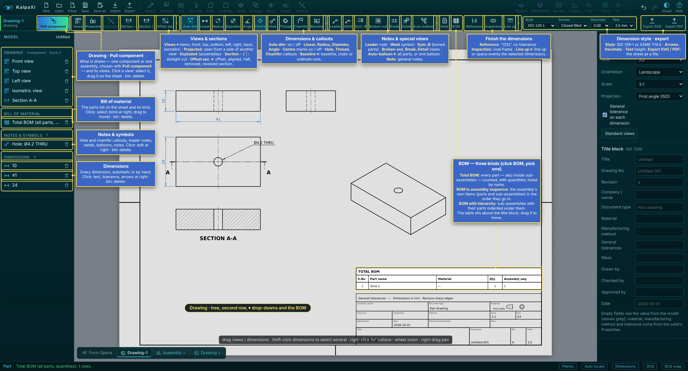

*A drawing: the tree on the left, the drawing bar with its ▾ drop-downs, and a bill of material on the sheet*

### The left side

- **Drawing** — what is drawn (one component or one assembly, chosen with **Pull component**) and its views. Click a view to select it and drag it on the sheet; the bin deletes it.
- **Bill of material** — the parts list on the sheet and its kind; click to change it or drag it.
- **Notes & symbols** — hole and chamfer callouts, leader notes, welds, balloons, notes; click to edit in the right panel.
- **Dimensions** — every dimension, automatic or by hand; click for its text, tolerance and arrows.

### The drawing bar

| Group                 | Tools                                                                                                                                                                                                                                                                             |
|-----------------------|-----------------------------------------------------------------------------------------------------------------------------------------------------------------------------------------------------------------------------------------------------------------------------------|
| Views & sections      | **Views** ▾ (front, top, bottom, left, right, back, isometric) · **Projected** (seen from a side of another view) · **Exploded** (assemblies) · **Section ─** / **Section │** (straight cut) · **Offset sec.** ▾: offset (stepped), aligned, half, removed and revolved sections. |
| Dimensions & callouts | **Auto dim** (on / off: the automatic dimensions; those placed by hand stay) · **Linear**, **Radius**, **Diameter**, **Angle** · **Centre** marks on / off · **Hole**, **Thread**, **Chamfer** callouts read from the model · **Baseline** ▾: baseline, chain or ordinate runs.   |
| Notes & special views | **Leader** · **Weld** · **Sym. Ø** (Ø to a centre line, turned parts) · **Broken-out** (local section) · **Break** (long views shortened, true sizes kept) · **Detail** · **Auto-balloon** ▾ (all parts, or one balloon) · **Note** · **BOM**.                                    |
| Finish the dimensions | **Reference** “(25)”, no tolerance · **Inspection** (oval frame) · **Line up** ▾: line up or space evenly the selected dimensions.                                                                                                                                                |
| Style · export        | **Style** ISO 129-1 or ASME Y14.5 · **Arrows** · **Decimals** · **Text** height · **Export SVG** / **Export PDF**.                                                                                                                                                                |

> **Tip:** A **▾** button holds several tools of one kind; the button shows the last one used. Click it to use that tool again, click ▾ to pick another.

### How to make a drawing — step by step

1.  Click **Drawing +** at the bottom left. A new tab **Drawing-1** opens with an empty A3 sheet; the second bar becomes the drawing bar.
2.  **Pull component** → choose **a component** (a solid of the Form Space) or **an assembly** (a deck). The **front, top, side and isometric** views are laid out on the sheet at a standard scale that fits.
3.  With nothing selected, the right panel holds the **Sheet** settings: size A4 … A0, landscape / portrait, scale, **projection** (First angle — ISO / Third angle — ASME) and the **title block** (title, drawing no., revision, material, mass, drawn / checked / approved by, date, company …). **Standard views** puts the views back in their places.
4.  Add more views: **Views** (front, top, bottom, left, right, back, isometric), **Section ─** / **Section │** and **Detail** (below).
5.  **Dimension** the views (below) and set their **tolerances**.
6.  Add **Note**, **Leader**, **Weld** symbols and, for an assembly, the **BOM**.
7.  **Export PDF** (prints at real size — choose “Save as PDF”) or **Export SVG** (real size in mm, for other CAD / documents).

> **Tip:** On the sheet: **left-drag** a view, dimension, note or the parts list to move it; **wheel** zooms; **right-drag** or **middle-drag** pans; right-click empty sheet → **Fit sheet**. <kbd>Del</kbd> deletes the selected item, <kbd>Esc</kbd> ends a tool. The Model list on the left lists views, dimensions, notes and the parts list — click to select, bin to delete.

### Views, sections and details

| Tool                        | How                                                                                                                                                                                                                                                                               |
|-----------------------------|-----------------------------------------------------------------------------------------------------------------------------------------------------------------------------------------------------------------------------------------------------------------------------------|
| **Views**                   | Pick a direction. Projected views keep in line with the front view (first or third angle). Right-click a view → **Show / Hide hidden lines** (dashed).                                                                                                                            |
| **Section ─** **Section │** | Click in a front, top, side, bottom or back view where the cut goes (snaps to hole centres and corners). A section view **A–A** is placed next to it with hatched cut faces and the cutting line with arrows on the parent view. Right-click it → **Flip the looking direction**. |
| **Detail**                  | Click the centre of the circle in a base or section view, then its size. The area is shown enlarged as **DETAIL B (5:1)** (letter on the circle); change its **Detail scale** and **Circle radius** in the panel.                                                                 |

### Dimensions

| Tool              | Pick                                                                                                 |
|-------------------|------------------------------------------------------------------------------------------------------|
| Linear            | Two points (corners, ends, centres), then place: horizontal or vertical by where you move the mouse. |
| Aligned           | Two points: the true distance, parallel to them.                                                     |
| Radius / Diameter | An arc or circle, then place the text (R… / Ø…).                                                     |
| Angle             | Two straight edges, then place the arc.                                                              |

- **Style** (in the bar): **ISO 129-1** (text along and above the line) or **ASME Y14.5** (text horizontal in a gap); arrowheads closed filled / open / oblique tick / dot; decimals; text height 2.5 – 7 mm.
- **Move:** drag the text to move it; drag the line or arrows to move the dimension line. Right-click → **Arrows inside (pointing out)** / **Arrows outside (pointing in)** / automatic, **Text back in place**.
- **Text / tolerance…** (right-click, or the panel): **Text** — `<>` stands for the measured value, so `4× <> THRU` gives “4× Ø6 THRU”. **Tolerance**: **General (from the solid)** — from the solid's Manufacturing method / tolerance (e.g. ISO 2768-m ±0.1; the **Feature** choice picks the right table, e.g. across a bend, broken edge); **Own tolerance** — e.g. `±0.05`, `H7`, `+0.02/0`; or **None**.
- **Model value**: which size in the model the dimension stands for — its own tolerance is then used for that size in the assembly [tolerance study](#assembly-decks-joints-constraints).

### Notes, leaders, weld symbols

- **Note** — general notes, one per line, numbered 1, 2, 3 … on the sheet, placed above the parts list (or the title block). Drag to move; right-click → **Put back above the parts list**.
- **Leader** — click where the arrow points (on an edge: arrowhead; inside a face: dot), then where the text goes, and type the note. Drag the tip or the text to change it.
- **Weld** — ISO 2553 / AWS A2.4 symbol: click the joint, then where the reference line starts. In the panel: weld type (fillet, square / V / bevel / U / J butt, plug / slot, spot, seam), **Arrow side / Other side / Both sides**, sizes (`a5`, `z7`, `s4`), length (`100` or `3×50 (100)`), **Site (field) weld** and the **Tail** (process, e.g. ISO 4063 `111`, `135`, `141`).

### Bill of material (parts list)

**BOM** on an assembly drawing puts a parts list above the title block. Click BOM and pick one of the three kinds:

- **Total BOM** — every solid part, also inside sub-assemblies, counted; listed by name.
- **BOM in assembly sequence** — the assembly's own items in the order they go in (sub-assemblies as one item).
- **BOM with hierarchy** — parts and sub-assemblies, with the parts of each sub-assembly indented under it.

Columns: S.No, Part name, Material, Qty, Assembly seq. Click the list to change its type, **Export CSV**, move it back **Above title block** or delete it.

> **Note:** The drawing shows the model as it is now — when the part changes, the views update. Check the dimensions and notes again after a change before you send the sheet out. Empty title-block fields use the values from the model (shown grey): material, manufacturing method and tolerance come from the solid's Properties.

# Analysis

*Stress and heat, results, fatigue and the molding check.*

## Mesh & FEM — stress and thermal analysis

KalpaXi checks solids for stress, deflection and temperature with the finite-element method. The mesh is made by **Gmsh** (second-order 10-node tetrahedra, CalculiX type **C3D10**, or first-order 4-node tetrahedra, **C3D4**) and the analysis is solved by **CalculiX**. Both run on your own computer through a small helper program, the **solver bridge**.

A **study** holds everything one analysis needs: the solids and their materials, the mesh settings, the supports, the loads and its own folder. What to define, in order: **analysis type → solids and materials → mesh → supports → loads → run**.

### One-time setup

1.  **Install CalculiX and Gmsh.** If **FreeCAD** is installed you already have both — they are in FreeCAD's `bin` folder and the bridge finds them automatically.  
    Windows: download the CalculiX Windows build (ccx, e.g. from *calculix.de* or the bConverged package) and Gmsh from *gmsh.info*.  
    Linux (Ubuntu/Debian): `sudo apt install calculix-ccx gmsh`  
    macOS: `brew install gmsh` and a CalculiX build (e.g. `brew install calculix-ccx` from a community tap).
2.  **Start the solver bridge** in a second terminal, in the kalpaxi folder: `npm run solver` (on Windows you can just double-click `start-solver.bat`). It prints where it found CalculiX and Gmsh and the folder where projects are stored (default: a `KalpaXi` folder in your home folder). Keep that window open.
3.  If a program is not found, copy `bridge/config.example.json` to `bridge/config.json` and put in the full paths of `ccx` and `gmsh` (and the project folder you want).

### Start a study, materials and the mesh

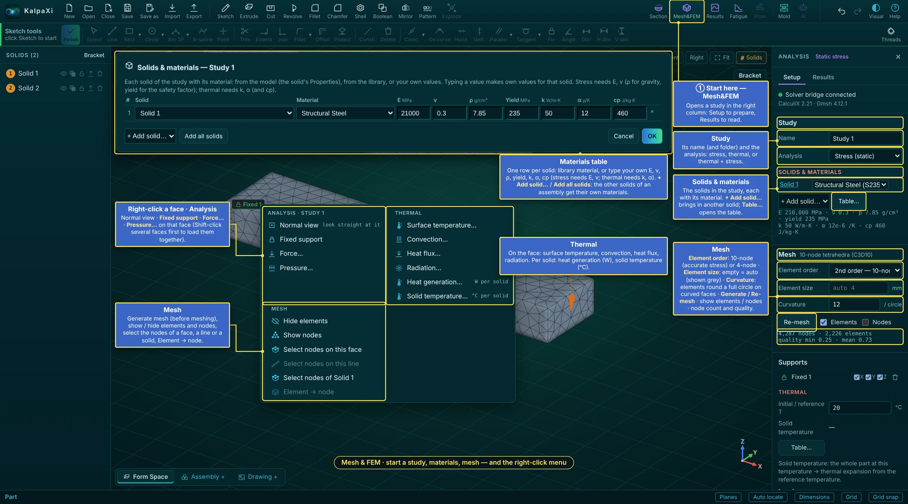

*Mesh&FEM: the Study, Solids & materials and Mesh sections, the materials table and the right-click menu*

1.  Click **Mesh&FEM** (top right). The **Analysis** panel opens on the right with a **Setup** and a **Results** tab; its first line shows whether the solver bridge is connected.
2.  **Study**: its **Name** (a new name = a new study with its own folder) and the **Analysis**: Stress (static), Thermal (steady state) or Thermal + stress (coupled).
3.  **Solids & materials**: the solids in the study, each with its material. **+ Add solid…** brings another solid in (for an assembly). **Table…** opens the materials table: one row per solid, a library material or your own values for E, ν, ρ, yield, k, α and cp (stress needs E and ν; ρ for gravity; yield for the safety factor; thermal needs k, α and cp). **+ Add solid…** / **Add all solids** in the table give the other solids of an assembly their own material.
4.  With several solids, **Contacts** lists where they touch: **Bonded** (glued — stress and heat pass fully) or **Contact** (surfaces may open and slide with friction μ). **Find contacts** looks for them again.
5.  **Mesh**: **Element order** — **2nd order, 10-node tet (C3D10)** is the default and the right choice for stress; **1st order, 4-node tet (C3D4)** is much smaller but too stiff in bending (stresses and deflections come out low unless the mesh is very fine — the panel warns); fine for quick checks and heat flow. **Element size**: empty = automatic (the value is shown grey). **Curvature**: how many elements go round a full circle on curved faces — more gives a finer mesh round holes and fillets. **Generate mesh** / **Re-mesh**; **Elements** and **Nodes** show the mesh; below: the node and element count and the element quality (1 = perfect, below 0.1 = poor).

### The right-click menu with Mesh&FEM open

- **Analysis**: Normal view, **Fixed support**, **Force…**, **Pressure…** on the face you clicked. <kbd>Shift</kbd>-click several faces (or lines) first to put one support or load on all of them — a force is then shared between the faces by their area.
- **Thermal**: on the face — surface temperature, convection, heat flux, radiation; per solid — **Heat generation…** (W) and **Solid temperature…** (°C).
- **Mesh**: generate mesh (before meshing), show / hide elements and nodes, select the nodes of a face, a line or a whole solid, **Element → node** (below).

### Supports, loads and temperatures

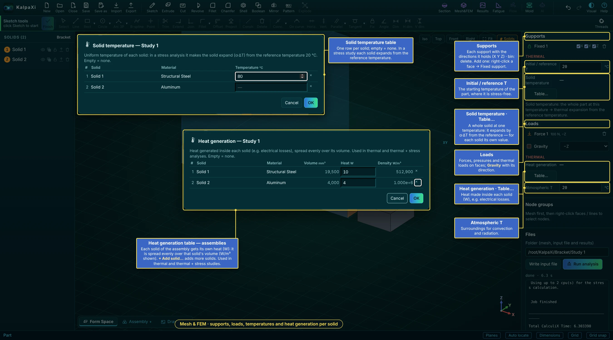

*Supports and loads, the initial temperature, and the per-solid tables for solid temperature and heat generation*

1.  **Supports:** right-click a face → **Fixed support**. In the list each support shows the directions it holds — untick X, Y or Z to hold only some (a roller / sliding support); the bin deletes it.
2.  **Loads:** right-click a face → **Force…** (total newtons, along the face normal or ±X/±Y/±Z, spread evenly over the face) or **Pressure…** (MPa; positive pushes into the face). Tick **Gravity** and pick its direction to add the parts' own weight. Click a load in the list to change it, or the bin to remove it. Supports show in green, loads as orange arrows.
3.  **Initial / reference T** (°C, under Supports → Thermal): the starting temperature of the parts, at which they are stress-free.
4.  **Solid temperature · Table…**: a whole solid at one temperature — one row per solid, empty = none. In a stress study each solid then expands by α·ΔT from the reference temperature, so a hot part in a cold frame gets thermal stress.
5.  **Heat generation · Table…** (under Loads → Thermal): the heat made inside each solid, in W (for example electrical losses in a coil or a chip). It is spread evenly over that solid's volume; the table shows the volume and the resulting W/m³. In an **assembly** each solid gets its own value — **+ Add solid…** adds more solids. Used in thermal and thermal + stress studies.
6.  **Atmospheric T**: the surroundings, used by convection and radiation unless they give their own T∞.

### Thermal analysis, and thermal + stress together

Choose the kind of analysis under **Study → Analysis**:

| Analysis                   | What CalculiX solves                                                                                                          |
|----------------------------|-------------------------------------------------------------------------------------------------------------------------------|
| Stress (static)            | Displacements and stresses from supports and loads. A **Solid temperature** makes the whole part expand by α·(T − reference). |
| Thermal (steady state)     | The temperature field and heat flow — no stresses.                                                                            |
| Thermal + stress (coupled) | Both at once: the computed temperatures expand the material and cause thermal stress, together with your mechanical loads.    |

Adding a thermal condition to a stress study (or a support / load to a thermal study) turns it into **Thermal + stress** automatically.

<table>
<colgroup>
<col style="width: 33%" />
<col style="width: 33%" />
<col style="width: 33%" />
</colgroup>
<thead>
<tr class="header">
<th>Where</th>
<th>Item</th>
<th>Meaning / units</th>
</tr>
</thead>
<tbody>
<tr class="odd">
<td rowspan="2">Supports → Thermal</td>
<td>Initial / reference T</td>
<td>°C — the starting temperature and the temperature at which the part is stress-free.</td>
</tr>
<tr class="even">
<td>Solid temperature (Table…)</td>
<td>°C per solid — the whole solid at one temperature (stress analysis only).</td>
</tr>
<tr class="odd">
<td rowspan="2">Loads → Thermal</td>
<td>Heat generation (Table…)</td>
<td>W per solid — heat generated inside each solid (e.g. electrical losses), spread over its volume.</td>
</tr>
<tr class="even">
<td>Atmospheric T</td>
<td>°C — the surroundings; used by convection and radiation unless they give their own T∞.</td>
</tr>
<tr class="odd">
<td rowspan="4">Right-click a face → <strong>Thermal</strong><br />
(or DOF on nodes)</td>
<td>Surface temperature…</td>
<td>°C — the face is held at this temperature.</td>
</tr>
<tr class="even">
<td>Convection…</td>
<td>h in W/m²K and T∞ °C: q = h·(T − T∞). Still air ≈ 5–25, forced air 25–250, water 500–10 000.</td>
</tr>
<tr class="odd">
<td>Heat flux…</td>
<td>W/m², positive = into the part.</td>
</tr>
<tr class="even">
<td>Radiation…</td>
<td>Emissivity ε (0–1) and T∞ °C: q = ε·σ·(T⁴ − T∞⁴).</td>
</tr>
</tbody>
</table>

Material thermal properties (conductivity k, expansion α, specific heat cp) come from the material list and are shown under the material.

**Thermal results:** Temperature (°C) and heat flux (total and X / Y / Z, W/m²) can be plotted; the summary gives the maximum / minimum temperature and maximum heat flux, and **Heat flow at fixed temperatures** lists the watts going in (+) or out (−) through every surface held at a temperature. Coupled results also have all the stress and displacement plots.

### Node groups and loads on nodes

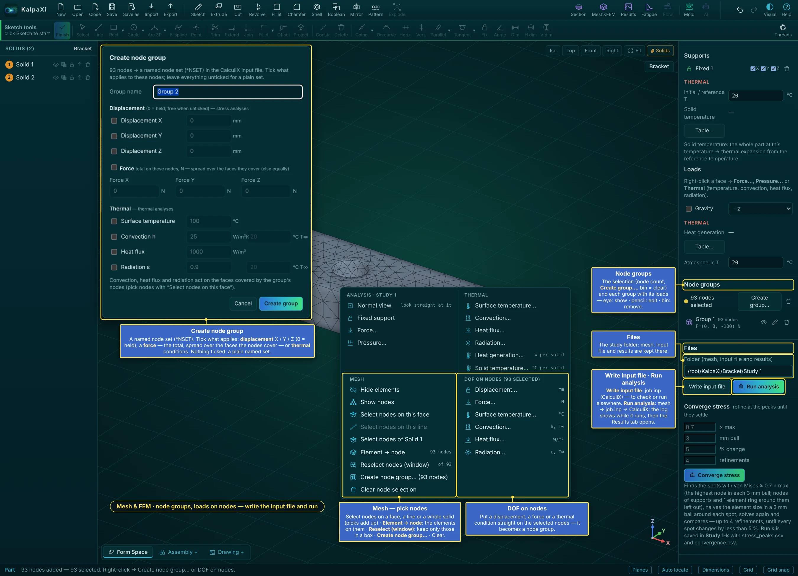

*Picking nodes, DOF on nodes, the Create node group window, and writing the input file and running*

For loads and supports that don't cover a whole face — a patch of a face, a line, part of an assembly — work on the **nodes** of the mesh. With the part meshed, **right-click** the model:

| Menu item                             | What it does                                                                                                                                                                                                                                                                                                                 |
|---------------------------------------|------------------------------------------------------------------------------------------------------------------------------------------------------------------------------------------------------------------------------------------------------------------------------------------------------------------------------|
| Generate mesh / Re-mesh (out of date) | Meshes the solid (also in the panel).                                                                                                                                                                                                                                                                                        |
| Show / Hide elements                  | Shows the mesh (elements and their edges) or the plain model.                                                                                                                                                                                                                                                                |
| Show / Hide nodes                     | Draws every node on the surface as a small dot.                                                                                                                                                                                                                                                                              |
| Select nodes on this face             | Adds all nodes of the face you right-clicked to the selection (yellow dots, visible through the part).                                                                                                                                                                                                                       |
| Select nodes on this line             | Right-click on (or very near) an edge of the model: adds all nodes along that line.                                                                                                                                                                                                                                          |
| **Reselect nodes (window)**           | Keeps only **part** of the selection: drag a window (rectangle) on the screen with the left button around the nodes to keep — the nodes outside it are dropped, through the whole depth of the part. Turn the view first so the nodes you want are inside the window. <kbd>Esc</kbd> or a right-click cancels. |
| Create node group… (n nodes)          | Asks for a **group name** and saves the selected nodes as a group (purple). It is written into the input file as a named node set (`*NSET`).                                                                                                                                                                                 |
| Clear node selection                  | Empties the selection.                                                                                                                                                                                                                                                                                                       |

When nodes are selected the menu also shows **DOF on nodes**:

- **Displacement…** (mm) — opens the node group window with X, Y and Z ticked at 0 (= held). Untick a direction to leave it free, or type a value to push / pull it (e.g. 0.05). Such a group is a support (green) and its reaction force appears in the results.
- **Force…** (N) — a total force with X / Y / Z parts (starts at Fz = −100 N) on the selected nodes. On nodes that cover whole faces it is spread as an even traction over those faces; otherwise it is shared equally between the nodes. It counts as a load, so the study can run with only this force.
- **Surface temperature… / Convection… / Heat flux… / Radiation…** — the same thermal conditions as on faces, applied to the faces covered by the selected nodes (red).

Each opens the **node group** window: the group name, the displacements (tick a direction and type its value), the force (Fx, Fy, Fz) and the four thermal conditions (tick and type the values; leave T∞ empty to use the atmospheric temperature). Leave everything unticked for a plain named set.

The panel's **Node groups** list shows each group with its node count and its values (e.g. `Ux=0.02 mm`, `F=(0, 0, −100) N`, `q=2000 W/m²`); the pencil opens the window to change them, clicking a name selects its nodes again, the bin deletes it. Groups remember the faces / lines and the window they were picked with, so they are found again after a re-mesh.

> **Tip:** **Example — a load on part of a face:** right-click the face → **Select nodes on this face**; right-click → **Reselect nodes (window)** and drag a window round the patch where the load acts; right-click → **Force…**, type the force, name the group, **OK**.

### Element groups

With nodes selected, right-click → **Element → node** selects the elements attached to them. The panel's **Element groups** section then offers **Create element group…**: a named element set (`*ELSET`) with its own **heat generation** (W or W/m³) and **acceleration** (along a direction) — added to the solid's own. Each group has an eye (highlight on / off), a pencil (edit) and a bin.

### Write the input file and run

- **Files** → **Folder**: the study folder, where the mesh, the input file and the results are kept.
- **Write input file** meshes if needed and writes `job.inp` only — to check it or run CalculiX yourself.
- **Run analysis**: mesh → `job.inp` → CalculiX. The solver log shows in the panel while it runs (**Stop** ends it); when it finishes the [Results](#results) tab opens.

### Where the files go

Each study has its own folder (shown under **Files**, and editable): `<projects folder>/<project>/<study>/` containing `model.step` (the solid), `mesh.msh` (Gmsh mesh), `job.inp` (the CalculiX input file), and the results `job.frd`, `job.dat`, `job.sta`, `job.cvg`, `solver.log`. The project itself (`<project>.kxi`) is saved in the project folder next to it. **Write input file** only writes `job.inp` — handy if you want to run CalculiX yourself or check it with CalculiX GraphiX (cgx).

> **Note:** Units are mm, N and MPa throughout. The analysis is **linear static**: small deflections, stress proportional to load, no contact between separate solids. Results right at sharp inside corners and at point-like supports grow when the mesh is refined (a stress singularity) — judge the stress a little away from them, or add a fillet.

## Results

**Results** (top right) opens the results panel for any study of this project — stress, thermal, coupled or [fatigue](#fatigue-pylife). The studies are read back from the project folder by the solver bridge, so results are there again after you reopen the project. After **Run analysis** the results open by themselves.

### Looking at a result

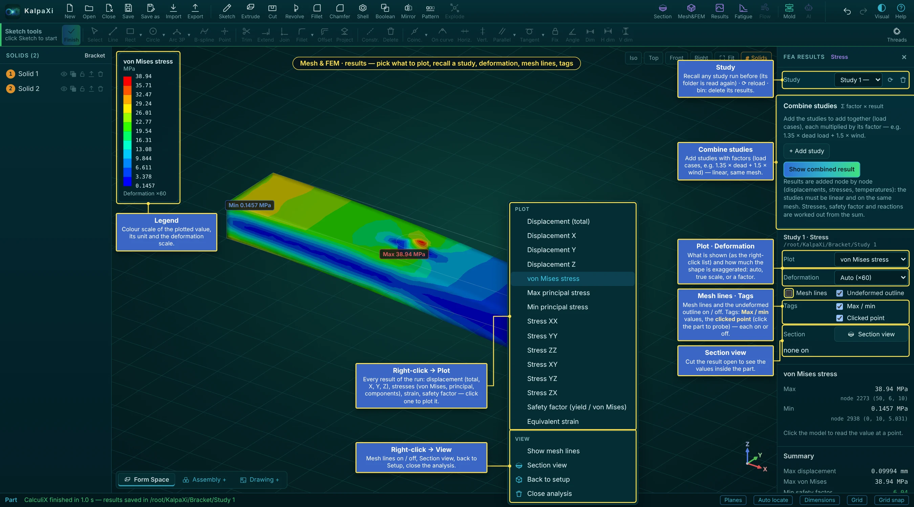

*A stress result: the legend, the right-click Plot and View menu, and the result settings on the right*

1.  **Plot**: displacement (total, X, Y, Z), von Mises stress, maximum / minimum principal stress, each stress component, equivalent strain, the **safety factor** (yield strength ÷ von Mises), temperature and heat flux (thermal), damage and life (fatigue). **Right-click the model** for the same list (**Plot**) and for **View**: mesh lines on / off, Section view, Back to setup, Close analysis.
2.  **Deformation**: Auto (exaggerated so you can see it — the factor is shown), Undeformed, True scale, ×10 / ×100 / ×1000. **Mesh lines** and **Undeformed outline** switch the thin lines on and off.
3.  The **legend** (top left) shows the colour bands, the unit and the deformation factor. **Tags** choose which labels are on the model: **Max / min**, the **Clicked point** (click the model to probe the value at a node), and — when there are — the fatigue **Critical node** and the **Converge regions**. Each can be switched off.
4.  **Section view** — cut the result open (up to 4 sections, as in the model): the cut faces show the values **inside** the part, and the panel shows the range **In the section**.
5.  Check the **Summary**: max displacement, max stress, min safety factor (green when 2 or more), and the **Reaction forces** at each support (they should balance your loads); thermal: heat flow at every fixed-temperature surface.

### The Results column — studies, combinations, export

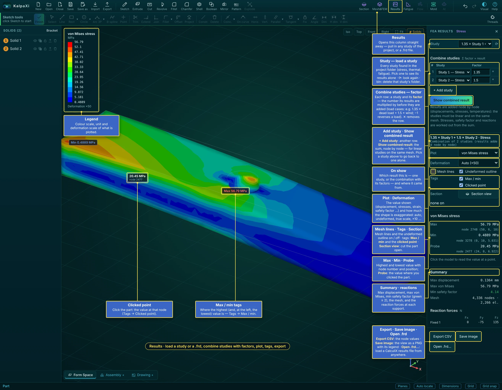

*The Results column: loading a study, combining studies with factors, plot settings, max / min / probe, summary and export*

| Item                                             | What it does                                                                                                                                                                                                                                                                              |
|--------------------------------------------------|-------------------------------------------------------------------------------------------------------------------------------------------------------------------------------------------------------------------------------------------------------------------------------------------|
| **Study**                                        | Loads a study: every study with results in the project folder (stress, thermal, fatigue). Pick one to see its results alone. ⟳ looks for studies again; the bin deletes that study's folder (mesh, input file, results) from disk after you confirm.                                      |
| **Combine studies**                              | Adds load cases together. Each row is a study and its **factor** — the number its results are multiplied by before they are added: e.g. 1.35 × dead load + 1.5 × wind; −1 reverses a load. ✕ removes a row.                                                                               |
| **+ Add study** · **Show combined result**       | Another row · the sum, node by node, shown like any result (its title lists the factors). Valid for **linear** studies on the **same mesh** (not with contact); stresses, safety factor and reactions are worked out from the sum. Pick a study in the Study list to see one alone again. |
| On show                                          | Which result this is — one study, or the combination with its factors — and its folder.                                                                                                                                                                                                   |
| Max · Min · Probe                                | The highest and lowest value with node number and position; **Probe**: the value where you clicked.                                                                                                                                                                                       |
| **Export CSV** · **Save image** · **Open .frd…** | Every node's values as CSV · the view as a PNG with its legend · load any CalculiX results file.                                                                                                                                                                                          |

- Each study keeps its own folder, so you can compare load cases by switching the Study list. Fatigue uses these stress studies as its load cases.
- Results stay on show while you place a section; close them with ✕ in the panel title.

### Converge stress — refine until the stress settles

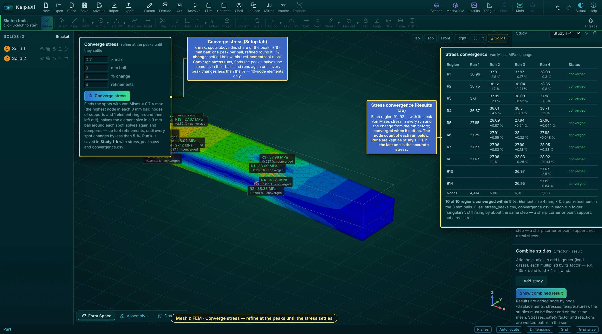

*Converge stress: the settings in the Setup tab, and the convergence table of the runs in the Results tab*

A peak stress depends on the mesh: finer elements at a notch give a higher, truer value until it stops changing. **Converge stress** (Setup tab, below Files) does this for you, for stress studies with 10-node elements:

1.  Set **× max** — spots with von Mises above this share of the peak are followed (≤ 1, default 0.7); **mm ball** — one peak per ball and the refined zone round it (default 3 mm); **% change** — settled below this (default 5 %); **refinements** — at most (default 4).
2.  **Converge stress**. Run 1 finds the peaks (nodes of supports and one element ring round them are left out). Each next run halves the element size in the balls round the open spots, solves again and compares — until every spot changes by less than the % or the refinements are used up. **Stop converging** ends it.
3.  The **Stress convergence** table (Results tab) lists each region R1, R2 … with its peak von Mises stress in every run and the change from the run before, the status (**converged**, **not converged**, **open** or **singular?**) and the node count of each run. Tags → **Converge regions** marks them on the model.

The runs are kept as **Study 1-1**, **Study 1-2** … (each with `stress_peaks.csv` and `convergence.csv`); the last one holds the accurate stress. **singular?** means the stress still rises by about the same step each run — a sharp corner or a point support, not a real stress.

## Fatigue (pyLife)

**Fatigue** turns the stresses of one or more **stress studies** into fatigue **damage** and **life** with <a href="https://github.com/boschresearch/pylife" rel="noopener" target="_blank">pyLife</a> (Bosch Research, open source, Apache-2.0): Wöhler (S-N) curve, mean-stress correction, rainflow counting and the Palmgren–Miner rule, at every node.

### One-time setup (Python and pyLife)

1.  Install **Python 3** (3.10 – 3.14 recommended) from python.org.
2.  Open the Fatigue panel: its first line shows which Python the bridge found and whether pyLife imports there. If not, it shows the exact commands for **that** Python, for example (Windows):  
    `py -m pip install numpy scipy "pandas>=2.2"`  
    `py -m pip install pylife --no-deps`  
    (`--no-deps` skips h5py, which KalpaXi doesn't need and which may not build on very new Python versions.)
3.  Press ⟳. If you have several Pythons, set `"python"` in `bridge/config.json` to the one with pyLife (e.g. `"C:\\Python314\\python.exe"`) and restart KalpaXi / the solver bridge.

### Setting up a fatigue study

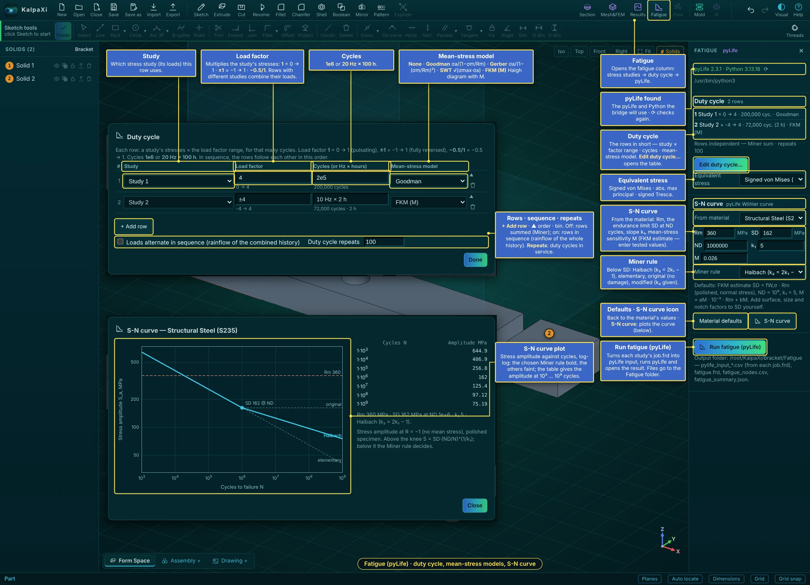

*The Fatigue column, the duty-cycle table, the mean-stress models and the S-N curve with its plot*

1.  Run the **stress studies** for your load cases first ([Mesh&FEM](#mesh--fem--stress-and-thermal-analysis) → Run analysis), e.g. “Bending” and “Torsion”. Use 2nd-order tets and refine at notches ([Converge stress](#converge-stress--refine-until-the-stress-settles) helps).
2.  **Fatigue** (top right). The first line shows the pyLife and Python the bridge will use (⟳ checks again). **Duty cycle** lists the rows in short.
3.  **Edit duty cycle…** opens the table. **+ Add row** per load, then for each row:
    - **Study** — which stress study (its loads) the row uses.
    - **Load factor** — multiplies the study's stresses: `1` = 0 → 1 (pulsating), `±1` = −1 → 1 (fully reversed), `-0.5/1` = −0.5 → 1.
    - **Cycles** — `1e6`, or `20 Hz × 100 h` (the life is then also given in hours).
    - **Mean-stress model** — **None** (amplitude only) · **Goodman** σa,eq = σa / (1 − σm/Rm) · **Gerber** σa,eq = σa / (1 − (σm/Rm)²) · **SWT** (Smith–Watson–Topper) √(σmax · σa) · **FKM (M)** the FKM Haigh diagram with the mean-stress sensitivity M.

    ▲ moves a row up, the bin removes it.
4.  How the rows combine: off — **rows independent, Miner sum** (D = Σ n/N); on — **Loads alternate in sequence (rainflow of the combined history)**, which also counts the big cycles from one load to the next. **Duty cycle repeats**: how often the duty cycle is run in service (damage = repeats × one duty cycle). **Done**.
5.  **Equivalent stress**: signed von Mises (default), abs. max principal or signed Tresca.
6.  **S-N curve**: **From material** fills Rm, the endurance limit **SD** at **ND** cycles, the slope **k₁** and **M** (FKM estimate) — or type tested values. **Miner rule** (below SD): Haibach (k₂ = 2k₁ − 1), elementary (k₂ = k₁), original (no damage below SD) or modified (k₂ given). **Material defaults** puts the estimate back. Apply surface, size and notch factors to SD yourself.
7.  The **S-N curve** icon plots the curve: stress amplitude against cycles, log-log, with the chosen Miner rule bold and the others faint, Rm and SD marked, and a table of the allowed amplitude at 10³ … 10⁹ cycles.
8.  **Run fatigue (pyLife)**: each study's `job.frd` is turned into pyLife input, pyLife runs (the log shows progress; **Stop** ends it) and the result opens.

### Fatigue results

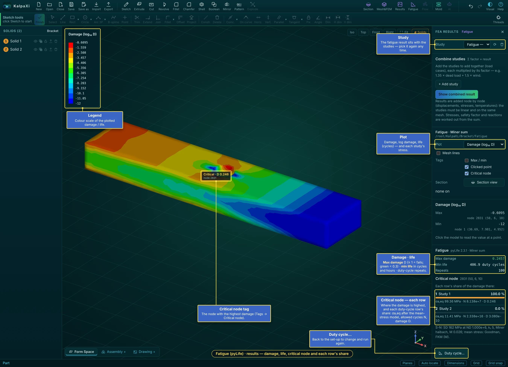

*A fatigue result: log damage, the critical node, damage and life, and each duty-cycle row's share*

- **Plot**: damage D, log₁₀ damage, **life** (log₁₀ duty cycles), and each row's damage and equivalent amplitude σa,eq — with legend, probe, tags and section view like any result. Tags → **Critical node** marks the node with the highest damage.
- **Max damage** (≥ 1 = fails within the duty cycles given; green below 0.3), **min life** in duty cycles (and hours when every row is in Hz × hours), and the repeats.
- **Critical node**: where the damage is highest, and each duty-cycle row's share there — σa,eq after the mean-stress model, the allowed cycles N and the damage D — so you see which load case to work on.
- The fatigue result appears in the Study list like the other studies. **Duty cycle…** goes back to the set-up to change it and run again.
- Files in `<project>/Fatigue/`: `pylife_input_*.csv` (stresses from each `job.frd`), `fatigue.frd` (opens in CalculiX GraphiX too), `fatigue_nodes.csv`, `fatigue_summary.json`, `fatigue.log`.

> **Note:** The default S-N data are rough FKM estimates for polished, unnotched material. Fatigue life is very sensitive to surface, notches, residual stress and the stress amplitude (a 10 % higher stress can halve the life) — use tested data and safety factors for real designs.

## Molding check (injection molding)

The **Mold** button (top right, after **Fatigue**) checks whether a solid can be injection molded, using the knowledge-based rules of the **Injection Molding DFM Rulebook**. Every finding names the rule it comes from (e.g. `WT-1`), so you can look it up in the table below. The check runs in the background in a second or two, then the panel shows the result and a colour map is drawn on the part.

### How to run a molding check — step by step

1.  Model the part as one solid with its real walls (shell it, add ribs, bosses, holes). Add draft to the walls if you have it — without draft every vertical wall is reported (DR-1).
2.  Click **Mold**. Pick the **Solid** and the **Material** (resin).
3.  **Opening**: leave **Propose** (KalpaXi tries the main directions and picks the one with the fewest undercuts), or right-click a face → **Open the mold along this face's normal**. The blue arrow shows it.
4.  Set **Texture**, **Side actions** allowed or not, **Cosmetic** part, and optionally your own **Gates** (Place gates… or right-click → **Put a gate here**).
5.  The check runs by itself. Go through the colour maps (**Thickness**, **Thick spots**, **Draft**, **Undercuts**, **Features**, **Fill**) and the **Findings** list — click a finding to see where it is and which rule and source it comes from.
6.  Change the model (thinner walls, more draft, core out bosses …) and press **Run again**. **Export CSV** saves the findings for your molder.

### Setting it up

| Setting      | What it does                                                                                                                                                                                                                                                                                                                                                                                                                                                                                |
|--------------|---------------------------------------------------------------------------------------------------------------------------------------------------------------------------------------------------------------------------------------------------------------------------------------------------------------------------------------------------------------------------------------------------------------------------------------------------------------------------------------------|
| Solid        | Which solid to check (shown when the model has more than one).                                                                                                                                                                                                                                                                                                                                                                                                                              |
| Material     | 16 molding resins with their wall range, draft, shrinkage and type (amorphous / semi-crystalline, glass-filled, flexible). The line under it shows the values used.                                                                                                                                                                                                                                                                                                                         |
| Opening      | The direction the mold opens (the cavity half moves this way; the core half the other way). **Propose** tries the X, Y and Z axes and the normals of the large flat faces and picks the one with the least undercut, then the least zero-draft area, then the largest shadow (parting line on the biggest silhouette). Or choose an axis, press **Pick a face for the direction**, or right-click a face → **Open the mold along this face's normal**. The blue arrow on the part shows it. |
| Texture      | Textured faces need more draft: light 3°, heavy 5°, leather 10°.                                                                                                                                                                                                                                                                                                                                                                                                                            |
| Side actions | If slides / lifters are not allowed, undercuts and side holes are errors instead of warnings.                                                                                                                                                                                                                                                                                                                                                                                               |
| Gates        | Proposed by KalpaXi, or your own: press **Place gates…** and click points on the part (click empty space to finish), or right-click → **Put a gate here**. **clear** goes back to the proposal.                                                                                                                                                                                                                                                                                             |
| Cosmetic     | Tick for a visible or glossy part: ribs may only be 40 % of the wall (instead of 60 %) and a sink mark opposite a rib, boss or gusset becomes an error.                                                                                                                                                                                                                                                                                                                                     |
| Resolution   | **Normal** measures about 40 000 surface points; **Fine** about 120 000, for small features (slower).                                                                                                                                                                                                                                                                                                                                                                                       |

Changing a setting or the model marks the result as out of date (the map is hidden) until you press **Run again**. The settings are saved in the `.kxi` project.

### Colour maps

| Map         | Shows                                                                                                                                                                                                                                                                                             |
|-------------|---------------------------------------------------------------------------------------------------------------------------------------------------------------------------------------------------------------------------------------------------------------------------------------------------|
| Thickness   | Wall thickness at every point: red = thinner than the material minimum (won't fill), purple = thicker than its maximum, blue → green → yellow inside the allowed range.                                                                                                                           |
| Thick spots | Diameter of the largest ball that fits in the material at each point, compared with the nominal wall: orange \> 2 × nominal (sink mark), red \> the material maximum (void / sink).                                                                                                               |
| Draft       | Green / blue = enough draft on the cavity / core side, yellow = less than needed, red = no draft at all, light grey = a curved face the parting line runs across, purple = undercut.                                                                                                              |
| Undercuts   | Orange = an undercut a straight side action can release, red = one that needs a lifter, insert or redesign.                                                                                                                                                                                       |
| Features    | What KalpaXi recognised: ribs (blue), gussets (teal), bosses (orange), holes (yellow), each tagged R1, G1, B1, H1 … on the part.                                                                                                                                                                  |
| Fill        | How the melt fills from the gate(s): blue at the gate → orange where it fills last, red where the flow is longer than the material allows. Drawn on top: the gates (red arrows), weld lines (purple lines, W1 …), the last points to fill (V1 …) and the proposed ejectors (white circles, E1 …). |

### Gates, filling and ejection (Release 3)

This is a **rule-based estimate**, not a mold-flow simulation: it follows the melt along the walls, but not its temperature, pressure or speed. Use it to place gates and spot problems early; confirm critical parts with a flow simulation or your molder.

- **Flow length** — for every point, the easiest path from the nearest gate, adding up length ÷ wall thickness along the way (so thin walls count more). The largest value is compared with the material's flow ratio L/t (ABS 200, PC 100, PP 250 …).
- **Gate proposal** — the point with the shortest longest flow (the centre of the part, GT-2), moved into a clearly thicker section if the flow stays well within the limit (GT-1); never on ribs, bosses or holes, or on the show side of a cosmetic part (GT-4). If one gate can't fill within 90 % of the limit, KalpaXi adds gates (up to 4) and lets each fill an equal share (GT-6).
- **Weld lines** — behind every through-opening (holes, windows, slots in flat walls): where the fill paths of neighbouring points went round opposite sides of it. Between gates: where their regions meet. The part where the two flows meet at more than 45° is reported as visible (WL-4). A weld line on a boss, or on the show side of a cosmetic part, is a warning (WL-1).
- **Stress at weld lines (WL-2)** — if stress results of the same solid are loaded (Stress → Results), the von Mises stress along each weld line is compared with 75 % of the material's yield strength (50 % for glass-filled resins).
- **Last to fill (GS-1)** — the points that fill last. On the outside edge the air leaves through the parting line (info); at the top of a rib or boss, or where fronts meet inside the part, it is a gas trap that needs a vent or an ejector pin (warning).
- **Ejection** — the part shrinks onto the half that has its cores (inside walls); ejectors push from that half. KalpaXi proposes a 3–8 mm pin on a flat spot within 10 mm (or 1.5 × the height) of every rib, boss and deep core wall, an ejector sleeve for a boss whose top faces the ejection side, and a blade on a rib top that has no flat spot nearby (EJ-3). Parts without such features get at least two pins, spread out. These distances and the minimum of two pins are KalpaXi's starting values (the rulebook has no published numbers).
- **Warp** — flat panels whose unsupported span is more than 50 × the wall (WP-3, KalpaXi's starting value); symmetric parts gated off the symmetry plane (WP-4).

### Ribs, gussets, bosses and holes

The **Features** list in the panel shows every recognised feature with its size (e.g. “Rib 1.2 mm thick, 6 mm high on a 2 mm wall”, “Boss ⌀8 × 10 mm, hole ⌀3 mm”) and how many warnings it has; click one to highlight it. Findings about a feature start with its label.

- **Rib** — two flat faces facing away from each other, closer than 2.5 × the nominal wall, joined by a free top face and both standing on the part (inside corners at the root). The outer wall of a box is *not* a rib (its outside has no root). The thickness is measured at the wall surface (past any root fillet), the height from the top to the wall.
- **Gusset** — the same thin web, with its free edge sloping between two supports that are not parallel (a floor and a wall).
- **Boss** — a round post (cylinder or drafted cone) all the way round one axis, standing on a wall at one end and free at the other. A hole on the same axis is its screw hole.
- **Hole** — a round hole all the way round one axis, smaller than half the part across it; through or blind (a floor at one end). Partial cylinders such as fillets and slot ends are not holes.

Sink marks (`SK-1`) are drawn on the face **opposite** the root of a too-thick rib, gusset or boss — that is where they will show.

**Click the part** to read the wall thickness, ball diameter and draft angle at that point. Right-click shows the opening-direction and map commands.

### Findings

Errors (can't be molded as drawn), warnings (a defect is likely) and info (advice, clamp force, mold shrinkage). Click a finding to highlight it on the part and see the rule text and its source. **Export CSV** saves the list. Below the findings: the opening direction, nominal / thinnest wall, thickest section, undercut and projected area, depth, clamp force and volume, and — when the direction was proposed — how the candidate directions compared.

### How it measures

- **Wall thickness** — from each surface point a ray goes straight into the part to the far side. Where that ray runs along a wall (the side of a plate, the top of a rib, the wall of a hole), the shortest chord across the wall is used instead.
- **Thick spots** — the largest ball that touches the surface at the point and stays inside the material (the "rolling ball" method).
- **Draft** — the angle between each face and the opening direction. **Undercuts** — surface points that can't see out of the part along the opening direction on their own side; each undercut is then tested along 8 sideways directions to find a side action that frees it.
- **Corners** — an edge where the faces meet at more than 20° has no fillet (inside = concave). Inside fillet radii come from how fast the surface normal turns.

### Rules checked in this release

| Rule                 | Check                                                                                                  | Severity                                    | Source                  |
|----------------------|--------------------------------------------------------------------------------------------------------|---------------------------------------------|-------------------------|
| WT-1                 | Wall thinner than the material minimum                                                                 | Error                                       | Protolabs, MoldMinds    |
| WT-2 · VD-1          | Section thicker than the material maximum (largest ball)                                               | Warning                                     | Protolabs, MoldMinds    |
| WT-3 · WP-2          | Thickest ÷ thinnest wall \> 1.5 (1.2 glass-filled), faces with ≥ 5 % of the area                       | Warning                                     | MoldMinds               |
| WT-6 · SK-2          | Thick spot \> 2 × nominal wall                                                                         | Warning                                     | RJC Mold, Protolabs     |
| WT-7                 | Walls under 1.0 mm (thin-wall molding)                                                                 | Info                                        | MoldMinds               |
| DR-1                 | Face parallel to the opening with 0° draft (nylon: info)                                               | Error                                       | Fictiv, Protolabs       |
| DR-2                 | Draft below the material / texture minimum                                                             | Warning                                     | Fictiv, Protolabs       |
| UC-1 · DR-4          | Surface hidden from the opening direction (undercut / negative draft); side-action direction suggested | Warning (Error if side actions not allowed) | Protolabs               |
| UC-3                 | Bump-off possible for flexible resins (LDPE, TPE / TPU)                                                | noted on UC-1                               | Protolabs               |
| UC-7                 | Number of side actions needed                                                                          | Info                                        | Protolabs               |
| CR-1                 | Sharp inside edge, or inside fillet radius \< 0.5 × nominal wall                                       | Warning                                     | Protolabs               |
| CR-2                 | Sharp outside edges (outside radius = inside + t)                                                      | Info                                        | Covestro                |
| WP-1                 | Semi-crystalline resin (shrink \> 1 %) with non-uniform walls                                          | Warning                                     | MoldMinds, Protolabs    |
| WP-6                 | Mold scale factor from the resin's shrinkage                                                           | Info                                        | RJC Mold, MoldMinds     |
| TL-3                 | Part size, volume, projected area and depth vs. typical rapid-tooling limits                           | Info                                        | Protolabs               |
| TL-4                 | Clamp force estimate from the projected area                                                           | Info                                        | MoldMinds               |
| Release 2 — features |                                                                                                        |                                             |                         |
| RB-1 · SK-1          | Rib base thicker than 60 % of its wall (40 % cosmetic) — sink on the opposite face                     | Warning (Error cosmetic)                    | Xometry                 |
| RB-2                 | Rib taller than 3 × its base thickness                                                                 | Warning                                     | Xometry, Covestro       |
| RB-3                 | Rib draft below 0.5° per side (info above 1.5°: thin top)                                              | Warning                                     | Xometry, Covestro       |
| RB-4                 | Rib / gusset root radius outside 0.5–1 × wall (sharp root included)                                    | Warning                                     | Xometry                 |
| RB-5                 | Gap between parallel ribs under 2.5 × wall (2 × for ribs lower than 3 × wall)                          | Warning                                     | Xometry, Covestro       |
| GU-1 · SK-1          | Gusset thicker than ⅔ of the wall it joins                                                             | Warning (Error cosmetic)                    | Covestro, Protolabs     |
| GU-2                 | Rib with free-standing ends                                                                            | Info                                        | Xometry                 |
| BS-1 · SK-1          | Boss wall over 60 % of the nominal wall, or a solid boss                                               | Warning (Error cosmetic)                    | HLH, Protolabs          |
| BS-2                 | Boss taller than 3 × its diameter (over 5 × = error)                                                   | Warning / Error                             | HLH, Covestro           |
| BS-3                 | Boss draft outside under 0.5°, hole under 0.25° (bosses along the opening)                             | Warning                                     | HLH                     |
| BS-4                 | Base radius under 0.25 × wall (sharp base or sharp hole bottom); info above 0.5 ×                      | Warning                                     | HLH                     |
| BS-5                 | Bosses closer than 2 × wall                                                                            | Warning                                     | HLH                     |
| BS-6                 | Solid plug under a boss hole (not cored down to the wall)                                              | Warning                                     | Covestro                |
| BS-7                 | Free-standing boss (no rib, gusset or wall tied to it)                                                 | Info                                        | HLH                     |
| BS-8                 | Boss and hole diameters to check against the screw maker's chart                                       | Info                                        | Covestro                |
| HL-1                 | Hole deeper than blind 2 D / 3 D (D under / over 5 mm), through 4 D / 6 D; over 12 D = error           | Warning / Error                             | PlasticsToday, Wevolver |
| HL-2                 | Less material than 1.5 × wall and 1.5 × D to the next hole or the edge                                 | Warning                                     | Wevolver                |
| HL-3                 | Floor under a blind hole thinner than 0.2 × D                                                          | Warning                                     | Wevolver                |
| HL-4                 | Hole not along the opening (side hole)                                                                 | Info (Error without side actions)           | Envalior                |
| HL-5                 | Weld line behind every cored hole                                                                      | Info                                        | Envalior                |

Rib and boss roots, and the draft of ribs and bosses, are judged by their own rules (RB-3 / RB-4, BS-3 / BS-4) instead of the general corner and draft rules, so they are not reported twice. Not checked: RB-6 (tapered rib thickness changes).

| Release 3 — gates, filling, ejection, warp |                                                                                                         |                                    |                           |
|--------------------------------------------|---------------------------------------------------------------------------------------------------------|------------------------------------|---------------------------|
| Rule                                       | Check                                                                                                   | Severity                           | Source                    |
| FL-1 · GS-2                                | Longest flow ÷ wall above the material's L/t (short shot; GS-2 when the last area is a thin rib)        | Error                              | MoldMinds, Daya Machinery |
| FL-2                                       | Flow above 80 % of the limit                                                                            | Warning                            | MoldMinds                 |
| GT-1 · VD-2                                | Gate in a thin wall while the part has much thicker sections                                            | Warning                            | Autodesk Moldflow         |
| GT-2                                       | Your gate gives more than 1.25 × the flow of a central gate                                             | Info                               | Autodesk Moldflow         |
| GT-3                                       | Long, narrow part (over 4 : 1): consider a gate at one end                                              | Info                               | Autodesk Moldflow         |
| GT-4                                       | Gate on a rib, boss or hole, or on the show side of a cosmetic part                                     | Warning                            | Autodesk Moldflow         |
| GT-6                                       | More than one gate needed (KalpaXi proposes them)                                                       | Info                               | Autodesk Moldflow         |
| WL-1 · GT-5                                | Weld line on a boss (screw load) or on the show side                                                    | Warning                            | Autodesk Moldflow         |
| WL-2                                       | Stress at a weld line above 75 % of yield (50 % glass-filled), from the stress results                  | Warning                            | Covestro                  |
| WL-3 · GS-1                                | Gas trap: last to fill at a rib / boss top or where fronts meet inside — vent it                        | Warning (Info on the outside edge) | Moldflow, Protolabs       |
| WL-4                                       | Weld line with its visible length                                                                       | Info                               | Covestro                  |
| WL-5                                       | Through-hole at the centre: a diaphragm gate avoids the weld line                                       | Info                               | Covestro                  |
| EJ-1                                       | A rib, boss or deep core wall with no flat landing spot nearby (and a summary of the proposed ejectors) | Warning                            | Fictiv, Protolabs         |
| EJ-2                                       | Cosmetic part: pin marks show on the ejection half                                                      | Info                               | Protolabs                 |
| EJ-3                                       | Ejector sleeves for bosses, blades for ribs                                                             | Info                               | Fictiv                    |
| EJ-4                                       | Pins landing on angled or curved faces                                                                  | Info                               | Protolabs                 |
| EJ-5                                       | Soft or sticky resin (TPE, TPU, PP, PE): more or wider pins                                             | Info                               | Protolabs                 |
| WP-3                                       | Flat panel span ÷ wall over 50                                                                          | Warning                            | RJC Mold (limit: KalpaXi) |
| WP-4                                       | Symmetric part, gating not symmetric                                                                    | Info                               | Autodesk Moldflow         |
| WP-5                                       | Sharp inside corners also add curl and warp (shown with CR-1)                                           | —                                  | Protolabs                 |

Flow ratios L/t used: ABS 200, PC/ABS 130, PC 100, PP 250, HDPE / LDPE 230, PS 200, PA 200, PA glass-filled 130, POM 150, PMMA 130, PBT / PET 180, TPE / TPU 140 (MoldMinds). PP glass-filled (200), PBT glass-filled (130) and PPS (150) are KalpaXi's starting values — no published figure was found. Your resin's spiral-flow data always wins.

Not checked: weld lines behind blind cores and openings in curved walls, snap fits, living hinges, threads and text (SF, LH, TH, TX), tolerances (TL-1, TL-2).

> **Note:** The limits are typical published values. Your resin supplier's data sheet and your molder's experience come first — a check that passes here is not a guarantee, and a warning is a prompt to look, not a verdict. Parts made in KalpaXi have no draft until you add it, so expect DR-1 on vertical walls.

### Sources

- <a href="https://protolabs.com/services/injection-molding/plastic-injection-molding/design-guidelines" rel="noopener" target="_blank">Protolabs — Injection molding design guidelines</a> (draft, size limits)
- <a href="https://www.protolabs.com/resources/design-tips/improving-part-design-with-uniform-wall-thickness/" rel="noopener" target="_blank">Protolabs — Improving part design with uniform wall thickness</a>
- <a href="https://www.protolabs.com/resources/design-tips/cutting-corners-on-injection-molded-parts/" rel="noopener" target="_blank">Protolabs — Cutting corners on injection-molded parts</a>
- <a href="https://www.protolabs.com/resources/design-tips/6-ways-to-achieve-undercut-success-in-molded-parts/" rel="noopener" target="_blank">Protolabs — 6 ways to achieve undercut success</a>
- <a href="https://www.protolabs.com/resources/guides-and-trend-reports/designing-for-moldability-complex-features/" rel="noopener" target="_blank">Protolabs — Designing for moldability: complex features</a>
- <a href="https://www.fictiv.com/articles/draft-angle-injection-molding" rel="noopener" target="_blank">Fictiv — Draft angle in injection molding</a>
- <a href="https://moldminds.com/blog/wall-thickness-injection-molding-guide/" rel="noopener" target="_blank">MoldMinds — Wall thickness guide by material</a>
- <a href="https://rjcmold.com/guides/wall-thickness-design/" rel="noopener" target="_blank">RJC Mold — Wall thickness design</a>, <a href="https://rjcmold.com/guides/injection-molding-defects-and-solutions/" rel="noopener" target="_blank">Defects and solutions</a>, <a href="https://rjcmold.com/wp-content/uploads/Shrinkage-Rates-for-Common-Plastics.pdf" rel="noopener" target="_blank">Shrinkage rates</a>
- <a href="https://solutions.covestro.com/-/media/covestro/solution-center/brands/downloads/imported/1557214249.pdf" rel="noopener" target="_blank">Covestro — Engineering Polymers: Part and Mold Design guide</a>
- <a href="https://www.xometry.com/resources/injection-molding/plastic-ribs-for-injection-molding-design/" rel="noopener" target="_blank">Xometry — Plastic ribs for injection molding design</a>
- <a href="https://help.autodesk.com/cloudhelp/2015/ENU/MoldflowAdvisor/files/GUID-CDD8CC94-4025-4D1B-AE09-E742BA0D633C.htm" rel="noopener" target="_blank">Autodesk Moldflow — Design rules of polymer injection locations</a>
- <a href="https://solutions.covestro.com/-/media/covestro/solution-center/whitepapers/understanding-and-optimizing-weld-lines-in-thermoplastic-molding.pdf" rel="noopener" target="_blank">Covestro — Understanding and optimizing weld lines</a>
- <a href="https://www.dayamachinery.com/flow-length-ratio-of-common-plastic/" rel="noopener" target="_blank">Daya Machinery — Flow length ratio of common plastics</a>
- <a href="https://www.protolabs.com/resources/design-tips/using-ejector-pins-properly-on-molded-parts/" rel="noopener" target="_blank">Protolabs — Using ejector pins properly</a>, <a href="https://www.fictiv.com/articles/injection-molding-ejection-systems-design-guide" rel="noopener" target="_blank">Fictiv — Ejection systems design guide</a>
- <a href="https://hlhrapid.com/knowledge/bosses-design-guide-injection-moulding/" rel="noopener" target="_blank">HLH — Bosses design guide</a>
- <a href="https://www.plasticstoday.com/plastics-processing/by-design-part-design-304-depth-of-holes" rel="noopener" target="_blank">PlasticsToday — Depth of holes (Beall)</a>, <a href="https://www.wevolver.com/article/everything-you-need-to-know-about-injection-molded-holes" rel="noopener" target="_blank">Wevolver — Injection-molded holes</a>, <a href="https://www.envalior.com/en-us/services/design-guide/design-guidelines/holes.html" rel="noopener" target="_blank">Envalior — Holes</a>

The full rulebook (all rules including Releases 2–3, with the 26 references and noted gaps) is the "Injection Molding DFM Rulebook" document.

## Flow and AI (frozen)

> **Note:** The **Flow** and **AI** buttons are **frozen** (greyed out) in this release. Flow is described below for reference — it comes back once running SU2 and showing its results inside KalpaXi are finished. **AI** (after Mold) is a place-holder for an assistant that will come later.

### Flow (CFD) — SU2 input files

The **Flow** button (top right) sets up a **steady, incompressible flow** of air, water or oil and writes the input files for the open-source CFD solver **SU2**: the fluid mesh `mesh.su2` and the case file `case.cfg`. Meshing uses Gmsh through the solver bridge, like the stress analysis. SU2 itself is only needed to run the files; the panel shows whether the bridge found it.

#### Two kinds of flow

| Flow                                                   | Fluid region                                                                                                                                                      | Boundaries                                                                                                                                                                                                                                                                        |
|--------------------------------------------------------|-------------------------------------------------------------------------------------------------------------------------------------------------------------------|-----------------------------------------------------------------------------------------------------------------------------------------------------------------------------------------------------------------------------------------------------------------------------------|
| **External** — air or water round a part               | A wind-tunnel box round the chosen solid, with the solid taken out. Its size is set in part lengths L: **Upstream** (2 L), **Downstream** (5 L), **Sides** (2 L). | Automatic: **inlet** on the upstream face (uniform speed), **outlet** downstream (0 Pa), **farfield** slip walls on the four sides, **wall** (no-slip) on the part. Choose the **Flow direction** (±X/±Y/±Z) or right-click a face → **Flow along / against this face's normal**. |
| **Internal** — flow through channels, pipes, manifolds | The chosen solid *is* the fluid: model the hollow inside as a solid (a Boolean Subtract of the part from a block, kept as a New solid, gives exactly this).       | Right-click a face of the fluid → **Inlet (velocity)…** (m/s, into the fluid, normal to the face), **Outlet (pressure)** (Pa, gauge) or **Symmetry (slip wall)**. Every other face is a no-slip wall. Values can be changed in the panel's list.                                  |

#### Fluid and turbulence

Pick a fluid (air or water at 20 / 60 °C, SAE 30 oil) or type your own **density** (kg/m³) and **viscosity** (Pa·s). The panel shows the **Reynolds number** Re = ρUL/μ (L = part length for external flow, the smallest size of the fluid region for internal flow) and says whether the flow is likely laminar or turbulent. **Turbulence**: Laminar, Spalart–Allmaras or k-ω SST. With a turbulence model it also shows an estimate of the first-cell **y+**; these models want y+ ≈ 1 at the walls.

#### Mesh

**Generate fluid mesh** makes **first-order 4-node tetrahedra** (CFD codes use cells without mid-side nodes). Cells are small at the walls (**Wall cell size**) and grow by about 20 % per cell to the **Far-field size** (external) or **Core cell size** (internal); both are automatic unless you type them. The table under the mesh lists every boundary with its type, number of faces and area — check it before writing the files. Right-click → **Hide / Show the fluid mesh**.

#### Writing and running

1.  Set the **Iterations** limit (SU2 stops earlier when the drag — external — or the pressure drop — internal — has settled) and the **Folder**.
2.  **Write SU2 files** saves `case.cfg` and `mesh.su2` there (with `domain.step`, `domain.geo` and `domain.msh`). **Download** gives the two files without the folder.
3.  Run SU2 in that folder: `SU2_CFD case.cfg`. Results: `flow.vtu` and `surface_flow.vtu` (open in ParaView), `history.csv` (residuals, drag CD and lift CL on the walls, average pressures and the pressure drop between inlet and outlet).

The mesh is written in **metres** and the case in SI units (Pa, m/s, kg/m³). Force coefficients use the part's frontal area (external) or the inlet area (internal) as reference area.

> **Note:** This first CFD release writes the files; running SU2 from the panel and showing the results on the model come next. The fluid mesh is tetrahedra only — no prism layers at the walls yet — so pressure drop and pressure forces are good, but wall shear and drag of streamlined parts at high Reynolds numbers are approximate. Checked: laminar pipe flow gives the Hagen–Poiseuille pressure drop (plus the entrance loss) within 2 %.

# Reference

*Menus, files, keys, troubleshooting and credits.*

## Right-click menus

| Right-click on…                           | Menu                                                                                                                                                                                                                                                                                                                                        |
|-------------------------------------------|---------------------------------------------------------------------------------------------------------------------------------------------------------------------------------------------------------------------------------------------------------------------------------------------------------------------------------------------|
| An edge of the solid                      | Fillet, Chamfer                                                                                                                                                                                                                                                                                                                             |
| A flat face                               | New sketch on this face, **Normal view**, Create a plane…, Extrude this face, Cut into this face, Move the solid, Boolean with another solid (with several solids), **Cut another solid with this face's plane…**, Properties, Face colour, **Solid colour** (that solid only). The title shows the solid, e.g. “Face · Solid 2 · Bracket”. |
| A curved face                             | Create a plane…, **Normal view**, Face colour, Solid colour                                                                                                                                                                                                                                                                                 |
| A datum plane (XY / XZ / YZ or your own)  | New sketch on that plane, **Normal view**, **Cut a solid with this plane…** ([Cut by surface](#boolean-cut-by-surface-with-a-plane-or-a-line)); Delete this plane (your own planes); **Show all solids** when some are hidden                                                                                                                                                  |
| A solid in the Solids list                | Rename…, Hide / Show, Make transparent, Lock / Unlock, Save as / Export…, Delete                                                                                                                                                                                                                                                            |
| A part in an assembly deck                | Move, Normal view, Section view                                                                                                                                                                                                                                                                                                             |
| A drawing view                            | Show / Hide hidden lines, Section — horizontal / vertical cut, Flip the looking direction (sections), Detail view, Delete view                                                                                                                                                                                                              |
| A drawing dimension / note                | Text / tolerance…, arrows inside / outside / automatic, Text back in place, Delete; notes: Edit text…, Put back above the parts list                                                                                                                                                                                                        |
| The model, while Mesh&FEM is open         | Fixed support, Force…, Pressure…, Thermal (surface temperature, convection, heat flux, radiation), **Mesh** (generate, show elements / nodes, select nodes on this face / line, **Reselect nodes (window)**, create node group, clear) and **DOF on nodes** (Displacement…, Force…, thermal)                                                |
| Empty space in an assembly deck           | Pull component…, Section view, Fit view, standard views                                                                                                                                                                                                                                                                                     |
| A deck tab (bottom left)                  | Rename…, Delete this deck                                                                                                                                                                                                                                                                                                                   |
| During a section, shell or joint step     | That step's commands, e.g. **Set section plane**, Done, Cancel                                                                                                                                                                                                                                                                              |
| Empty space                               | New sketch, Extrude, Cut, Revolve, Fillet, Chamfer, Boolean (Combine / Subtract / Cut by surface)…, views, undo/redo, save, export                                                                                                                                                                                                          |
| The part, while the molding check is open | Open the mold along / against this face's normal, Reverse the opening direction, Let KalpaXi propose the direction, **Put a gate here**, Clear my gates, the colour maps (incl. Features and Fill), Run again, Close                                                                                                                        |
| Anywhere while sketching                  | All drawing, editing, constraint and dimension commands, and Finish sketch                                                                                                                                                                                                                                                                  |

Right-**dragging** pans (or turns the view while sketching or in a step) — the menu only opens on a click.

## Saving, opening, exporting

<table>
<colgroup>
<col style="width: 50%" />
<col style="width: 50%" />
</colgroup>
<thead>
<tr class="header">
<th>Button</th>
<th>What it does</th>
</tr>
</thead>
<tbody>
<tr class="odd">
<td><strong>Save</strong> <kbd>Ctrl</kbd>+<kbd>S</kbd></td>
<td>Saves the project as a <code>.kxi</code> file (the full editable history). After a <strong>Save as</strong> into a chosen folder, Save writes to that same file again; otherwise it downloads.</td>
</tr>
<tr class="even">
<td><strong>Save as</strong> <kbd>Ctrl</kbd>+<kbd>Shift</kbd>+<kbd>S</kbd></td>
<td>Opens the <strong>Save as / Export</strong> window (below): file name, folder, file type <strong>.kxi</strong> or <strong>STEP</strong>, and whether to save the whole model or one solid.</td>
</tr>
<tr class="odd">
<td><strong>Open</strong></td>
<td>Loads a <code>.kxi</code> file. The file window's type list has <strong>KalpaXi project (*.kxi)</strong> and <strong>All files</strong>.</td>
</tr>
<tr class="even">
<td><strong>Close</strong></td>
<td>Closes the current project and leaves an empty, untitled model (asks first if there are unsaved changes).</td>
</tr>
<tr class="odd">
<td><strong>Export</strong></td>
<td><strong>STEP</strong> (exact solid for other CAD programs), <strong>STL</strong> (3D printing), <strong>DXF</strong> (the selected sketch, for laser/CNC), <strong>PNG</strong> (picture of the view).</td>
</tr>
<tr class="even">
<td><strong>Import</strong></td>
<td>A menu with the two file types:<br />
• <strong>KalpaXi project (.kxi)</strong> — open it for editing (replaces the current project);<br />
• <strong>KalpaXi project as a solid</strong> — rebuild that project and add its solid to the current model;<br />
• <strong>STEP (.step / .stp)</strong> — add a STEP solid to the current model.</td>
</tr>
<tr class="odd">
<td><strong>New</strong></td>
<td>Starts an empty project. A window asks for the <strong>Project name</strong> and where to keep it — <strong>Choose folder…</strong>, as in Save as. With a folder, the project file is created there at once and <strong>Save</strong> keeps writing to it; without one, Save downloads the file.</td>
</tr>
<tr class="even">
<td><strong>Section</strong></td>
<td>Section view — see <a href="#section">Section view</a>.</td>
</tr>
<tr class="odd">
<td><strong>Mesh&amp;FEM</strong></td>
<td>Mesh, supports, loads, run CalculiX — see <a href="#fea">Mesh &amp; FEM</a>. The analysis tools are greyed out inside an assembly deck or a drawing.</td>
</tr>
<tr class="even">
<td><strong>Results</strong></td>
<td>Plot the results of any study — see <a href="#results">Results</a>.</td>
</tr>
<tr class="odd">
<td><strong>Fatigue</strong></td>
<td>Damage and life with pyLife — see <a href="#fatigue">Fatigue</a>.</td>
</tr>
<tr class="even">
<td><strong>Mold</strong></td>
<td>Molding check — see <a href="#mold">Molding check</a>.</td>
</tr>
<tr class="odd">
<td><strong>Flow</strong> <strong>AI</strong></td>
<td>Frozen for now (greyed out) — see <a href="#cfd">Flow and AI</a>.</td>
</tr>
</tbody>
</table>

### The Save as / Export window

Open it from the **Save as** button, from right-click on a face → **Save as / Export…** (that solid is pre-selected, as STEP), or from the export icon next to a solid in the **Solids** list.

| Field        | Meaning                                                                                                                                                                                                                                                                                     |
|--------------|---------------------------------------------------------------------------------------------------------------------------------------------------------------------------------------------------------------------------------------------------------------------------------------------|
| File name    | Name without extension; the line at the bottom shows the final file name.                                                                                                                                                                                                                   |
| Save as type | **KalpaXi project (\*.kxi)** or **STEP (\*.step)**.                                                                                                                                                                                                                                         |
| Contents     | **Whole model** or one solid (**Solid 1**, **Solid 2**, …). A whole-model .kxi is fully editable. A single solid saved as .kxi holds that solid as fixed (imported) geometry with its material — not its sketches.                                                                          |
| Save in      | **Choose folder…** picks the folder (Chrome and Edge; the browser asks once to allow editing files there). Without a folder, or in Firefox / Safari, the file goes to the browser's download folder — turn on “Ask where to save each file” in the browser settings to be asked every time. |

### Solid numbers

Every separate solid gets a number, shown as an orange tag on the model and in the **Solids** list under the feature tree. A solid keeps its number when you edit, rebuild, save and reopen; a new solid gets the next number (several new ones are numbered left to right). Click a solid in the list for its properties; the **\# Solids** button at the top right of the view hides or shows the tags.

Each row of the **Solids** list has five buttons: **eye** — hide / unhide the solid; **two squares** — transparent / opaque; **padlock** — lock (see [Solids](#solids-colour-name-lock)); **arrow** — Save as / Export; **bin** — delete the solid. Right-click a solid in the list for the same commands and **Rename…**. A hidden solid can't be clicked in the view (its number tag turns grey); bring it back with its eye button or right-click empty space or a plane → **Show all solids**. Hiding and transparency only change the view — the solid is still part of the model, its mass and its exports — and they are saved in the project.

### Deleting a solid

Click the **bin** button of a solid in the **Solids** list (or right-click it there → **Delete**). A locked solid must be unlocked first. A warning window lists every feature that will be removed — the extrudes, revolves, imports, **cuts**, **fillets**, **chamfers** and moves that build that solid, and the **sketches** they use — and asks you to confirm with **Delete** (Cancel or <kbd>Esc</kbd> keeps everything).

- A fillet or chamfer that also rounds edges of other solids is kept; only this solid's edges are taken out of it.
- A cut that also cuts other solids is kept.
- If one extrude built this solid *and* another one (for example one sketch with two separate shapes), the window warns that the other solid will be deleted too.
- A sketch is deleted only when nothing else uses it.
- The other solids keep their numbers. Undo (<kbd>Ctrl</kbd>+<kbd>Z</kbd>) brings everything back.
- **Solids from a Boolean:** deleting a kept original switches off its **Keep** option in that Boolean (the Boolean uses it up). Deleting a Boolean's result deletes the Boolean feature when both originals were kept; otherwise the Boolean is marked “result deleted” (its panel has **Bring back**). A solid made by a **New solid** extrude goes with that extrude and its sketch.

> **Note:** Your work is also **autosaved in this browser** and restored when you reopen the page — but clearing browser data removes it. Use **Save** for real backups.

## Keyboard shortcuts

| Anywhere                                                                                                            |                                                                                                  |
|---------------------------------------------------------------------------------------------------------------------|--------------------------------------------------------------------------------------------------|
| <kbd>Ctrl</kbd>+<kbd>Z</kbd> / <kbd>Ctrl</kbd>+<kbd>Y</kbd> | Undo / redo                                                                                      |
| <kbd>Ctrl</kbd>+<kbd>S</kbd>                                                            | Save project                                                                                     |
| <kbd>Ctrl</kbd>+<kbd>Shift</kbd>+<kbd>S</kbd>                             | Save as / Export…                                                                                |
| <kbd>F</kbd>                                                                                          | Fit view                                                                                         |
| <kbd>F1</kbd>                                                                                         | This help                                                                                        |
| <kbd>Esc</kbd>                                                                                        | Cancel / clear selection / close menu                                                            |
| Middle mouse click                                                                                                  | Finish / Done of the current step (sketch, depth, move, edges, shell, plane, section, part move) |
| <kbd>Enter</kbd>                                                                                      | Finish / Done of the current step                                                                |

| Part mode                    |                                                 |
|------------------------------|-------------------------------------------------|
| <kbd>K</kbd>   | New sketch (on the selected face/plane, if any) |
| <kbd>E</kbd>   | Extrude                                         |
| <kbd>Del</kbd> | Delete the selected feature                     |

| Drawing                      |                                                         |
|------------------------------|---------------------------------------------------------|
| <kbd>Del</kbd> | Delete the selected view, dimension, note or parts list |
| <kbd>Esc</kbd> | End the current tool                                    |
| Wheel · right / middle drag  | Zoom · pan the sheet                                    |

| Assembly deck                                 |                                                    |
|-----------------------------------------------|----------------------------------------------------|
| <kbd>Del</kbd>                  | Remove the picked component from the deck          |
| <kbd>Esc</kbd>                  | Deselect; cancel a joint or a move                 |
| <kbd>Shift</kbd> while dragging | Turn instead of slide (cylindrical, planar joints) |

| Sketch mode                                                                                                                                                                                  |                                                       |
|----------------------------------------------------------------------------------------------------------------------------------------------------------------------------------------------|-------------------------------------------------------|
| <kbd>S</kbd> <kbd>L</kbd> <kbd>R</kbd> <kbd>C</kbd> <kbd>A</kbd> <kbd>B</kbd> <kbd>P</kbd> | Select, Line, Rectangle, Circle, Arc, B-spline, Point |
| <kbd>X</kbd> <kbd>W</kbd> <kbd>J</kbd> <kbd>U</kbd>                                                                                  | Trim, Extend, Join corner, Project                    |
| <kbd>D</kbd> <kbd>N</kbd> <kbd>Shift</kbd>+<kbd>H</kbd> <kbd>Shift</kbd>+<kbd>V</kbd>                    | Dimension, Angle, Horizontal / Vertical dimension     |
| <kbd>H</kbd> <kbd>V</kbd> <kbd>E</kbd> <kbd>T</kbd> <kbd>O</kbd>                                                       | Horizontal, Vertical, Equal, Tangent, On curve        |
| <kbd>G</kbd>                                                                                                                                                                   | Construction on/off                                   |
| <kbd>Del</kbd>                                                                                                                                                                 | Delete selection                                      |
| <kbd>Enter</kbd>                                                                                                                                                               | Finish a B-spline                                     |
| <kbd>Ctrl</kbd>+<kbd>Enter</kbd>                                                                                                                                 | Finish the sketch                                     |

## When something goes wrong

| Message / problem                                                                   | What to do                                                                                                                                                                                |
|-------------------------------------------------------------------------------------|-------------------------------------------------------------------------------------------------------------------------------------------------------------------------------------------|
| "The sketch has no closed profile"                                                  | The shape has a gap. Look for an end point that isn't joined — drag it onto the neighbouring point, or use **Join corner**. Closed areas are shaded blue.                                 |
| "That would conflict with existing constraints"                                     | The new rule contradicts another one (e.g. a locked length). Unlock or delete the other dimension first.                                                                                  |
| Red constraint markers                                                              | The sketch can't be solved — remove one of the red constraints listed in the panel.                                                                                                       |
| "OpenCascade could not create this fillet"                                          | The radius is too large for that edge — try a smaller size or fewer edges.                                                                                                                |
| A feature shows a ⚠ in the Model list                                               | Click it to read the reason in the panel. Often an earlier sketch changed — edit the feature or re-pick its edges.                                                                        |
| "The shell can't be made with … walls"                                              | The inside walls would run into a hole, pocket or round. Use a thinner wall, or switch off that feature.                                                                                  |
| "… belongs to Solid N, which is locked"                                             | Unlock the solid with its padlock button in the Solids list.                                                                                                                              |
| "… is already placed by …" (assembly)                                               | A part can have one placing joint. Delete that joint first, or pick another part to move.                                                                                                 |
| Part of the model is missing                                                        | A section may be on: open **Section** and untick it (or **All off**).                                                                                                                     |
| "The cutting surface doesn't pass through the solid" / "… must form one open chain" | Cut by surface: move the plane or line so it crosses the part; the sketch must have one open line chain (no closed outline, no branch).                                                   |
| "pyLife does not import in …" (Fatigue)                                             | Run the two `pip install` commands the panel shows — for **that** Python, with `--no-deps` — then ⟳. Or set `"python"` in `bridge/config.json` to the Python that has pyLife and restart. |
| "The solver bridge is not running"                                                  | Start KalpaXi with `KalpaXi.bat` / `kalpaxi.sh` (or `npm run solver`) and keep its window open.                                                                                           |
| "Add a load first" / "Add a support first"                                          | A stress study needs at least one support (a face or a node group with a displacement) and one load (force, pressure, gravity, a node-group force, or a temperature).                     |
| The model disappeared                                                               | Press <kbd>F</kbd> (Fit) or click **Iso**. In a deck, check the component isn't hidden.                                                                                     |

## Open-source acknowledgements

**KalpaXi is built on open-source software.** The geometry kernel, the sketch solver, the 3D view, the mesher, the FEA solver and the fatigue library are all made and shared freely by people and companies around the world. Thank you to everyone who writes, tests and maintains them. If KalpaXi is useful to you, please support these projects too — use them, report bugs, contribute fixes, cite them in your work, or sponsor them. Open source works when we all give a little back.

### Inside KalpaXi (shipped with the app)

| Project                                                                                                                                                                                                                                                                        | What it does here                                                                          | Licence     | Licence text                                                                                                                                                      |
|--------------------------------------------------------------------------------------------------------------------------------------------------------------------------------------------------------------------------------------------------------------------------------|--------------------------------------------------------------------------------------------|-------------|-------------------------------------------------------------------------------------------------------------------------------------------------------------------|
| <a href="https://dev.opencascade.org" rel="noopener" target="_blank">Open CASCADE Technology</a> (as WebAssembly by <a href="https://github.com/sgenoud/replicad" rel="noopener" target="_blank">replicad-opencascadejs</a>) — © Open Cascade SAS and contributors             | The 3D geometry kernel: solids, Booleans, cuts, fillets, shells, STEP, drawing projections | LGPL-2.1    | <a href="licenses/OpenCascade-replicad-opencascadejs-LGPL-2.1.txt" target="_blank">LGPL-2.1</a>                                                                   |
| <a href="https://replicad.xyz" rel="noopener" target="_blank">replicad</a> — © 2023 QuaroTech Sàrl (Steve Genoud)                                                                                                                                                              | The modelling library on top of OpenCascade                                                | MIT         | <a href="licenses/replicad-MIT.txt" target="_blank">MIT</a>                                                                                                       |
| <a href="https://github.com/Salusoft89/planegcs" rel="noopener" target="_blank">PlaneGCS</a> — FreeCAD's 2D constraint solver, © the FreeCAD contributors, packaged by Salusoft89                                                                                              | Sketch constraints and dimensions                                                          | LGPL-2.0+   | <a href="licenses/PlaneGCS-LGPL-2.1.txt" target="_blank">LGPL-2.1</a>                                                                                             |
| <a href="https://threejs.org" rel="noopener" target="_blank">three.js</a> — © 2010–2026 three.js authors                                                                                                                                                                       | The 3D view, picking and labels                                                            | MIT         | <a href="licenses/three.js-MIT.txt" target="_blank">MIT</a>                                                                                                       |
| <a href="https://opentype.js.org" rel="noopener" target="_blank">opentype.js</a> — © 2020 Frederik De Bleser                                                                                                                                                                   | Reading fonts (used by replicad)                                                           | MIT         | <a href="licenses/opentype.js-MIT.txt" target="_blank">MIT</a>                                                                                                    |
| <a href="https://github.com/mourner/flatbush" rel="noopener" target="_blank">flatbush</a> and <a href="https://github.com/mourner/flatqueue" rel="noopener" target="_blank">flatqueue</a> — © Vladimir Agafonkin                                                               | Fast spatial search (used by replicad)                                                     | ISC         | <a href="licenses/flatbush-ISC.txt" target="_blank">flatbush</a>, <a href="licenses/flatqueue-ISC.txt" target="_blank">flatqueue</a>                              |
| <a href="https://github.com/foliojs/tiny-inflate" rel="noopener" target="_blank">tiny-inflate</a> — © Devon Govett; <a href="https://github.com/mathiasbynens/String.prototype.codePointAt" rel="noopener" target="_blank">String.prototype.codePointAt</a> — © Mathias Bynens | Helpers used by opentype.js                                                                | MIT         | <a href="licenses/tiny-inflate-MIT.txt" target="_blank">tiny-inflate</a>, <a href="licenses/string.prototype.codepointat-MIT.txt" target="_blank">codePointAt</a> |
| <a href="https://github.com/JulietaUla/Montserrat" rel="noopener" target="_blank">Montserrat</a> font — © The Montserrat Project Authors                                                                                                                                       | Lettering of the logo tagline on the start-up picture                                      | SIL OFL 1.1 | <a href="licenses/Montserrat-OFL-1.1.txt" target="_blank">OFL-1.1</a>                                                                                             |

OpenCascade and PlaneGCS are used **unmodified**, as separate WebAssembly files that can be replaced by another build of the same library; their source code is at the links above.

### Programs KalpaXi works with (you install them)

| Program                                                                                                                                                                                                                   | What it does here                                   | Licence      | Licence text                                                                                                                             |
|---------------------------------------------------------------------------------------------------------------------------------------------------------------------------------------------------------------------------|-----------------------------------------------------|--------------|------------------------------------------------------------------------------------------------------------------------------------------|
| <a href="http://www.calculix.de" rel="noopener" target="_blank">CalculiX</a> (ccx) — © Guido Dhondt                                                                                                                       | The FEA solver: stress, thermal, coupled            | GPL-2.0      | <a href="licenses/GPL-2.0-Gmsh-CalculiX.txt" target="_blank">GPL-2.0</a>                                                                 |
| <a href="https://gmsh.info" rel="noopener" target="_blank">Gmsh</a> — © Christophe Geuzaine and Jean-François Remacle                                                                                                     | The tetrahedral mesher (Mesh, Flow)                 | GPL-2.0+     | <a href="licenses/GPL-2.0-Gmsh-CalculiX.txt" target="_blank">GPL-2.0</a>                                                                 |
| <a href="https://github.com/boschresearch/pylife" rel="noopener" target="_blank">pyLife</a> — © Robert Bosch GmbH and the pyLife authors                                                                                  | Fatigue: Wöhler curve, rainflow, mean stress, Miner | Apache-2.0   | <a href="licenses/pyLife-Apache-2.0.txt" target="_blank">Apache-2.0</a>, <a href="licenses/pyLife-NOTICE.txt" target="_blank">NOTICE</a> |
| <a href="https://numpy.org" rel="noopener" target="_blank">NumPy</a>, <a href="https://scipy.org" rel="noopener" target="_blank">SciPy</a>, <a href="https://pandas.pydata.org" rel="noopener" target="_blank">pandas</a> | Numbers and tables for the fatigue script           | BSD-3-Clause | at each project                                                                                                                          |
| <a href="https://www.python.org" rel="noopener" target="_blank">Python</a> · <a href="https://nodejs.org" rel="noopener" target="_blank">Node.js</a>                                                                      | Run the fatigue script · run the solver bridge      | PSF · MIT    | at each project                                                                                                                          |
| <a href="https://www.freecad.org" rel="noopener" target="_blank">FreeCAD</a> (optional — brings CalculiX and Gmsh)                                                                                                        | —                                                   | LGPL-2.0+    | freecad.org                                                                                                                              |
| <a href="https://su2code.github.io" rel="noopener" target="_blank">SU2</a> (Flow — frozen)                                                                                                                                | CFD solver for the written case files               | LGPL-2.1     | su2code.github.io                                                                                                                        |

Built with <a href="https://vite.dev" rel="noopener" target="_blank">Vite</a> (MIT) and <a href="https://www.typescriptlang.org" rel="noopener" target="_blank">TypeScript</a> (Apache-2.0); tested with <a href="https://playwright.dev" rel="noopener" target="_blank">Playwright</a> (Apache-2.0). The full list with versions is in `THIRD-PARTY-NOTICES.md` in the KalpaXi folder.

### Why this matters — and what you can do

- **Free to use, study, change and share.** These licences let anyone — students, small workshops, big companies — use world-class engineering software without licence fees.
- **Keep the notices.** If you pass KalpaXi on, keep the `licenses` folder and `THIRD-PARTY-NOTICES.md` with it. If you change OpenCascade or PlaneGCS, share your changes under the LGPL; if you bundle CalculiX or Gmsh, include their GPL text and source link.
- **Give back.** Star, cite, report a bug, write documentation, answer a question in a forum, or sponsor a project you rely on.

